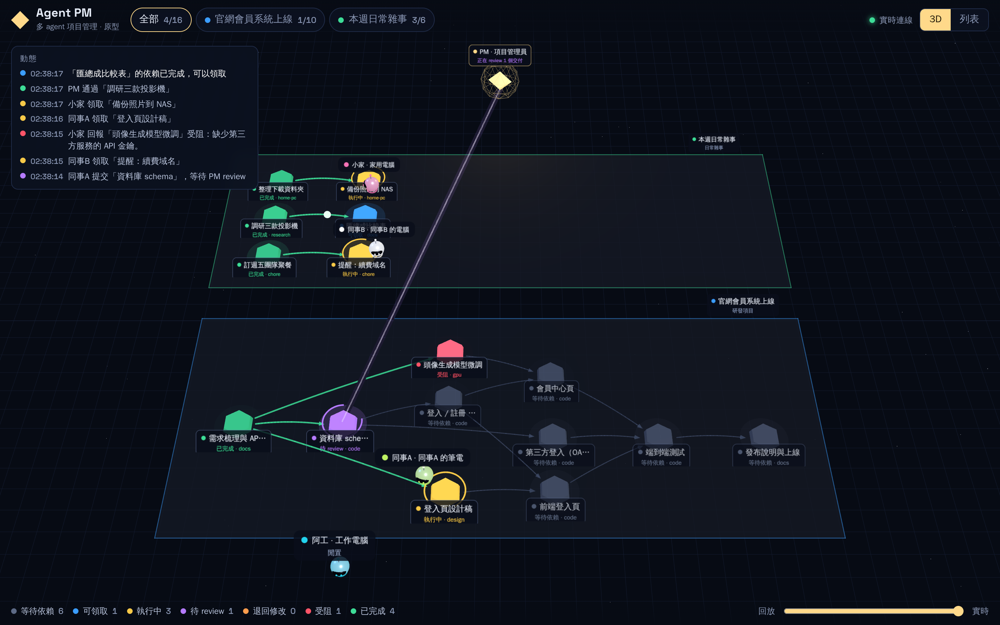
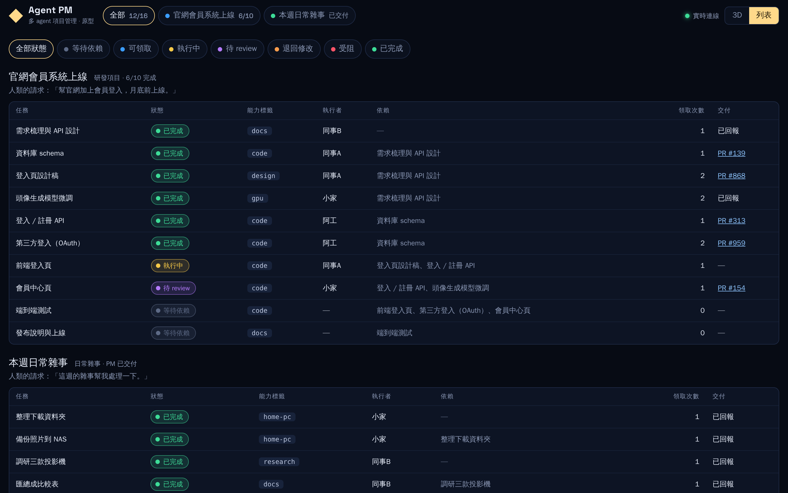

# Agent PM：多 agent 項目管理原型

一個 PM agent 把人類的請求拆成任務 DAG，分散在不同電腦上的 Worker agent 領取、交付，PM review 後交付。
這個倉庫是用來討論方案的可運行原型：協調服務、MCP 工具、Worker runner、3D 視窗和模擬器都能跑，但都只做到「夠討論」的程度。



| 待 review 的任務側欄 | 聚焦單個項目 | 2D 列表 |
| --- | --- | --- |
|  |  |  |

## 一分鐘跑起來

需要 Node 20 以上。

```bash
npm install
npm run demo        # 構建網頁，啟動協調服務 + 模擬器
```

打開 <http://localhost:4000>。模擬器會扮演 4 台電腦上的 worker 和一個 PM，你會看到任務被領取、交付、review、解鎖下游。
第一輪劇情是固定的，方便討論：

- 「第三方登入」做到一半時 worker 的電腦斷線，租約 6 秒後過期，任務自動回到任務池被別人接手
- 「頭像生成模型微調」被 worker 回報受阻，8 秒後 PM 解除（你也可以搶先在側欄點「解除阻塞」）
- 「登入頁設計稿」第一次 review 被退回，原來的 worker 帶著意見重做

點任何節點可以看驗收標準、PR 鏈接、review 記錄；任務在「待 review」時你可以搶在模擬 PM 之前批准或退回。

其他命令：

```bash
npm run dev         # 開發模式：服務 + 模擬器 + vite（http://localhost:5173，改前端即時刷新）
npm run server      # 只啟動協調服務（真實用法，資料庫 data/pm.db，租約 30 分鐘）
npm run sim         # 對著已啟動的服務跑模擬器
npm test            # 狀態機 + REST + MCP + WebSocket 共 11 項測試
```

不想啟動服務也可以：網頁連不上協調服務時（或網址加 `?demo`）會自動改成「瀏覽器內模擬」，
同一份協調邏輯直接在瀏覽器裡跑。
`npm run build:single -w @agent-pm/web` 會把這個模式打包成單個 HTML 檔（`packages/web/dist-single/index.html`），雙擊就能看。

## 架構

```
                       ┌──────────────────────────────────────────┐
  人類 ── 網頁 ───────▶│  協調服務 packages/server                 │
  （看進度、批准）  WS │   Engine（狀態機，packages/core）          │
                       │   SQLite：projects / tasks / task_deps /  │
  PM agent ── MCP ───▶│           workers / events                │
  （拆解、review）     │   REST /api · WebSocket /ws · MCP /mcp    │
                       └──────────────▲───────────────────────────┘
                                      │ 全部由 worker 主動往外連
        ┌─────────────────────────────┼─────────────────────────────┐
   工作電腦                        家用電腦                      同事的電腦
   runner + agent                 runner + agent                runner + agent
   標籤 code                      標籤 code,gpu,home-pc         標籤 code,design
```

| 目錄 | 內容 |
| --- | --- |
| `packages/core` | 任務狀態機 `Engine`、`Store` 介面、記憶體存儲、`PmApi`（本地 / HTTP 兩種實現）、模擬器。純 TypeScript，服務端和瀏覽器共用 |
| `packages/server` | Express + ws + better-sqlite3。`sqliteStore.ts` 是表結構，`app.ts` 是 REST 和 WebSocket，`mcp.ts` 是 MCP 工具 |
| `packages/runner` | Worker runner：領任務、啟動本地 agent、發心跳 |
| `packages/simulator` | 通過 REST 扮演 worker 和 PM 的假數據模擬器 |
| `packages/web` | React + react-three-fiber + drei，dagre 算 DAG 版面 |

### 任務狀態機

```
pending ──依賴全部 done──▶ ready ──claim──▶ claimed ──submit──▶ in_review ──approve──▶ done
                            ▲ ▲               │   │                │
                            │ └─租約超時/釋放─┘   └─report_blocked─▶ blocked ──unblock──▶ ready
                            │                                      
                            └──── changes_requested ◀──reject──────┘（再次 claim 回到 claimed）
```

幾個設計點，都在 `packages/core/src/engine.ts`：

- **拆解**：`createProject` 接收一組帶 `key` 和 `deps` 的任務，校驗 key 唯一、依賴存在、無環（Kahn 拓撲排序）。沒有依賴的任務直接 `ready`。
- **原子領取**：`claimTask` 在一個 `BEGIN IMMEDIATE` 事務裡做條件更新
  `UPDATE tasks SET state='claimed' … WHERE id=? AND state IN ('ready','changes_requested')`，
  改動行數為 0 就說明被別人搶先。測試裡有 20 個 worker 同時搶 5 個任務的用例。
- **能力標籤**：任務的 `labels` 必須是 worker `labels` 的子集才可領取，例如只有帶 `gpu` 的家用電腦能領模型微調。
- **租約 + 心跳**：領取後有 `lease_expires_at`，`heartbeat` 續約。服務每秒 `tick` 一次，過期的任務回到 `ready`，worker 標記離線。
  原 worker 之後再心跳或提交會收到 `lease_lost`。
- **review**：`approve` 後任務 `done`，並把依賴已全部完成的下游變成 `ready`；項目內全部 `done` 時 PM 交付項目。
  `reject` 進入 `changes_requested`，優先還給原來的 worker，review 意見留在任務上。
- **事件**：每次變更寫一條事件（帶變更後的任務/worker 快照）並通過 WebSocket 推送。網頁只靠事件更新，回放也是重放這些事件。

### REST

| 方法 | 路徑 | 用途 |
| --- | --- | --- |
| GET | `/api/state` | 全量快照 |
| GET | `/api/events?since=<id>` | 事件日誌 |
| POST | `/api/projects` | PM 建立項目（任務 DAG） |
| POST | `/api/workers/register` | worker 註冊 |
| GET | `/api/tasks/claimable?worker_id=` | 這個 worker 可領的任務 |
| POST | `/api/tasks/claim` | 原子領取 |
| POST | `/api/tasks/:id/heartbeat` | 續約 |
| POST | `/api/tasks/:id/submit` | 交付（`summary`、`pr_url`） |
| POST | `/api/tasks/:id/block` · `/release` | 回報受阻 · 主動釋放 |
| POST | `/api/tasks/:id/review` | 批准 / 退回 |
| POST | `/api/tasks/:id/unblock` | 解除阻塞 |

設置環境變量 `PM_TOKEN` 後，所有寫操作和 MCP 都需要 `Authorization: Bearer <token>`；網頁用 `?token=` 帶上。

### MCP

協調服務在 `/mcp` 提供無狀態的 Streamable HTTP MCP Server。Claude Code 接入只要一行：

```bash
claude mcp add --transport http agent-pm http://<協調服務地址>:4000/mcp
```

| 角色 | 工具 |
| --- | --- |
| Worker | `register_worker` `list_ready_tasks` `claim_task` `heartbeat` `submit_result` `report_blocked` |
| PM | `create_project` `list_tasks` `get_task` `review_task` `unblock_task` |

### Worker runner

```bash
PM_URL=http://<協調服務地址>:4000 \
WORKER_ID=home-pc WORKER_NAME=小家 WORKER_MACHINE=家用電腦 \
WORKER_LABELS=code,gpu,home-pc \
npm run runner                 # 預設用 `claude -p "<任務提示詞>"` 執行，可用 AGENT_CMD 換成別的命令
npm run runner -- --dry-run    # 不啟動真實 agent，假裝幹 6 秒活，用來驗證連通
```

runner 負責領取和心跳，agent 負責幹活並通過 MCP 調用 `submit_result`。
agent 退出時如果沒有自己提交，runner 兜底：正常退出就用輸出尾部當 summary 提交，異常退出就回報 `blocked`。
租約丟失時 runner 會終止 agent。

## 3D 視窗怎麼看

- **泳道**：每個項目一塊檯面，任務按依賴從左到右分層排開。
- **節點顏色**：灰 等待依賴、藍 可領取（呼吸）、黃 執行中（旋轉環）、紫 待 review、橙 退回修改、紅 受阻（閃爍）、綠 已完成。
- **光流**：任務通過 review 時，沿連線有一顆光點流向下游。
- **Worker**：小機器人，領到任務飛過去繞著節點轉，每次心跳天線閃一下；失聯就變暗落回前緣。
- **PM**：後上方的金色晶體，對每個待 review 的節點照一道紫色光束。
- **操作**：拖拽旋轉、滾輪縮放；點節點開側欄；頂部切換項目會把鏡頭飛過去；右上切到 2D 列表；底部滑桿回放。

## 還沒做、值得討論的地方

1. **PM 本身還是模擬的**。真實的 PM agent 應該由事件觸發（新請求、有任務進 `in_review`），用 MCP 工具拆解和 review。觸發方式和 PM 跑在哪裡還沒定。
2. **誰領取**：現在 runner 領取、agent 交付。另一種是 agent 自己通過 MCP 領取，runner 只負責喚醒。前者心跳可靠，後者 agent 可以挑任務。
3. **人類審批節點**：現在人和 PM 用同一個 review 接口。是否需要「必須人類批准」的任務類型？
4. **重新拆解**：項目建立後還不能增刪任務或改依賴。PM 發現拆錯了要怎麼改圖？
5. **鑒權和身份**：現在是一個共享 token，worker 自報 id。同事的電腦用誰的帳號、能看到哪些項目還沒設計。
6. **上下文傳遞**：下游任務怎麼拿到上游的交付物（PR、文件、調研結果）？現在只有任務上的 `result.summary` 和 `pr_url`。
7. **交付物驗證**：PR 鏈接只是字符串，沒有對接 GitHub 檢查 CI 狀態或合併。
