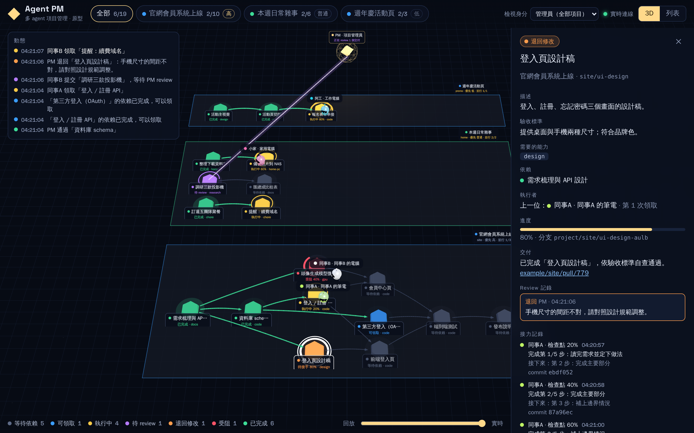
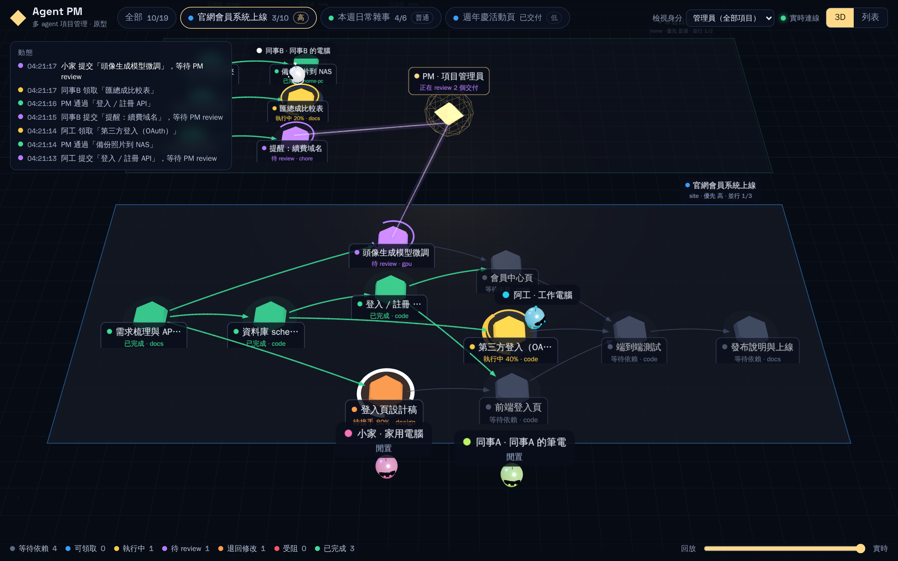
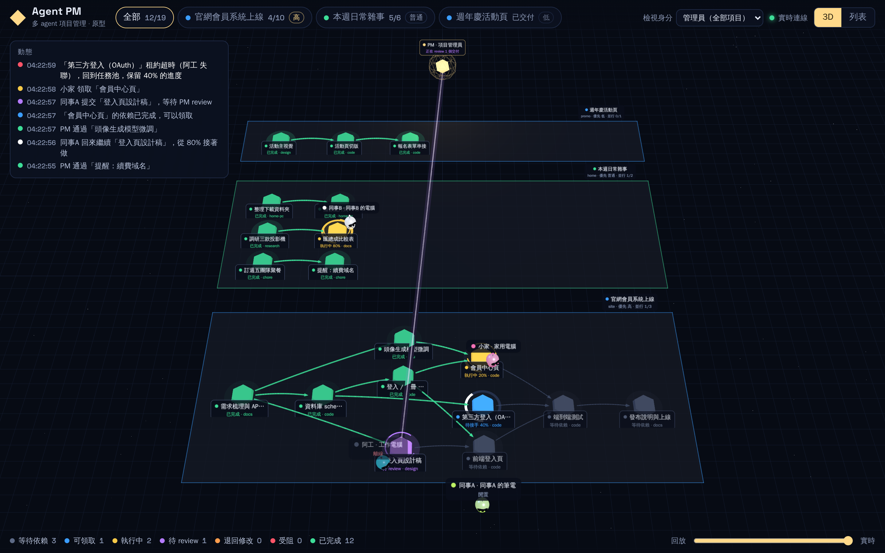
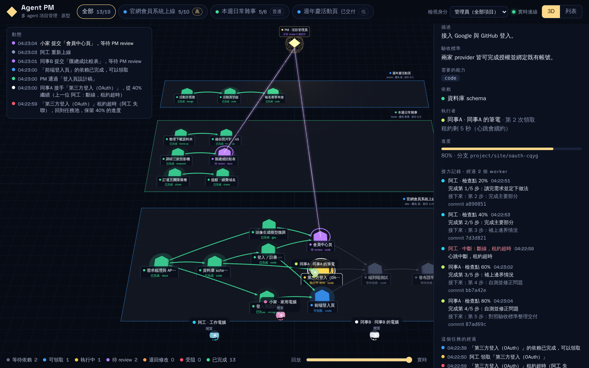
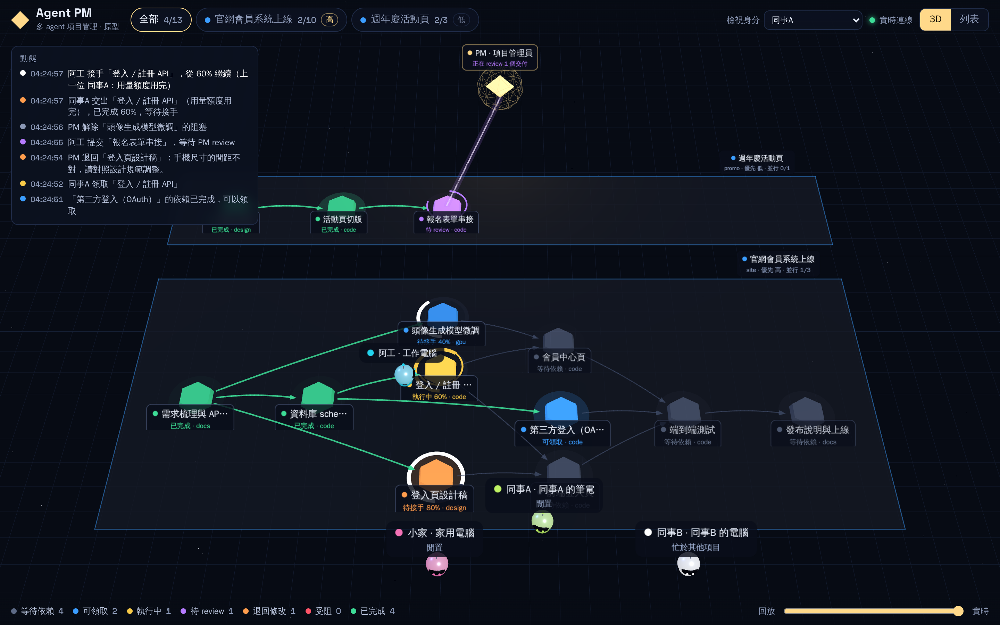
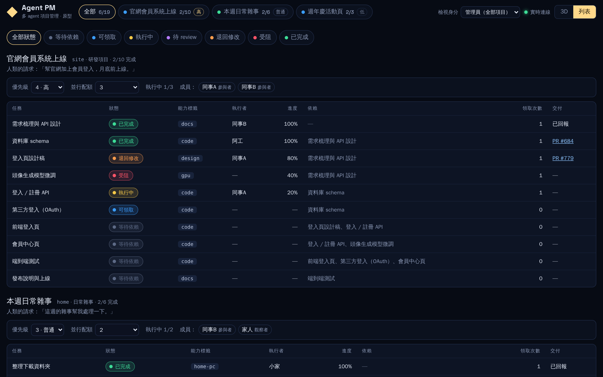

# Agent PM：多 agent 項目管理原型

一個 PM agent 管理多個項目：把每個請求拆成任務 DAG，分散在不同電腦上的 Worker agent 領取、交付，PM review 後交付。
這個倉庫是用來討論方案的可運行原型：協調服務、MCP 工具、Worker runner、3D 視窗和模擬器都能跑，但都只做到「夠討論」的程度。


| 待 review 的任務側欄 | 聚焦單個項目 | 2D 列表 |
| --- | --- | --- |
|  |  |  |

| 斷線後等人接手（白色進度環） | 接力記錄：兩個 worker 接著做完 |
| --- | --- |
|  |  |

| 以同事A 的身分檢視：只看得到他參與的兩個項目 | 項目設定：優先級、並行配額、成員 |
| --- | --- |
|  |  |

**想一步步驗收和上手操作，請看 [docs/TUTORIAL.md](docs/TUTORIAL.md)。**

## 一分鐘跑起來

需要 Node 20 以上。

```bash
npm install
npm run demo        # 構建網頁，啟動協調服務 + 模擬器
```

打開 <http://localhost:4000>。模擬器會扮演 4 台電腦上的 worker 和一個 PM，同時管三個項目（優先級和並行配額各不相同），你會看到任務被領取、交付、review、解鎖下游。
右上角的「檢視身分」可以換成同事A、同事B、家人的視角，看看每個人看得到哪些項目。
第一輪劇情是固定的，方便討論：

- 「調研三款投影機」做到 40% 被人工打斷，任務帶著進度回到任務池
- 「頭像生成模型微調」被 worker 回報受阻，8 秒後 PM 解除（你也可以搶先在側欄點「解除阻塞」）
- 「登入 / 註冊 API」做到 60% 時 agent 額度用完，另一個 worker 從 60% 接著做
- 「登入頁設計稿」第一次 review 被退回，原來的 worker 帶著意見重做
- 「第三方登入」做到 40% 時 worker 的電腦斷線，租約 6 秒後過期，另一個 worker 從 40% 接手

點任何節點可以看驗收標準、PR 鏈接、review 記錄；任務在「待 review」時你可以搶在模擬 PM 之前批准或退回。

其他命令：

```bash
npm run dev         # 開發模式：服務 + 模擬器 + vite（http://localhost:5173，改前端即時刷新）
npm run server      # 只啟動協調服務（真實用法，資料庫 data/pm.db，租約 30 分鐘）
npm run sim         # 對著已啟動的服務跑模擬器
npm test            # 狀態機 + REST + MCP + WebSocket + 續作 + 多項目，共 24 項測試
```

不想啟動服務也可以：網頁連不上協調服務時（或網址加 `?demo`）會自動改成「瀏覽器內模擬」，
同一份協調邏輯直接在瀏覽器裡跑。
`npm run build:single -w @agent-pm/web` 會把這個模式打包成單個 HTML 檔（`packages/web/dist-single/index.html`），雙擊就能看。

## 架構

```
                       ┌──────────────────────────────────────────┐
  人類 ── 網頁 ───────▶│  協調服務 packages/server                 │
  （看進度、批准）  WS │   Engine（狀態機，packages/core）          │
                       │   SQLite：projects / tasks / task_deps /  │
  PM agent ── MCP ───▶│     workers / users / project_members /   │
                       │     events                                │
  （拆解、review）     │   REST /api · WebSocket /ws · MCP /mcp    │
                       └──────────────▲───────────────────────────┘
                                      │ 全部由 worker 主動往外連
        ┌─────────────────────────────┼─────────────────────────────┐
   工作電腦                        家用電腦                      同事的電腦
   runner + agent                 runner + agent                runner + agent
   標籤 code                      標籤 code,gpu,home-pc         標籤 code,design
```

| 目錄 | 內容 |
| --- | --- |
| `packages/core` | 任務狀態機 `Engine`、權限層 `Scoped`（`access.ts`）、`Store` 介面、記憶體存儲、`PmApi`（本地 / HTTP 兩種實現）、模擬器。純 TypeScript，服務端和瀏覽器共用 |
| `packages/server` | Express + ws + better-sqlite3。`sqliteStore.ts` 是表結構，`app.ts` 是 REST 和 WebSocket，`mcp.ts` 是 MCP 工具 |
| `packages/runner` | Worker runner：領任務、啟動本地 agent、發心跳 |
| `packages/simulator` | 通過 REST 扮演 worker 和 PM 的假數據模擬器 |
| `packages/web` | React + react-three-fiber + drei，dagre 算 DAG 版面 |

### 任務狀態機

```
pending ──依賴全部 done──▶ ready ──claim──▶ claimed ──submit──▶ in_review ──approve──▶ done
                            ▲ ▲               │   │                │
                            │ └─租約超時/交出─┘   └─report_blocked─▶ blocked ──unblock──▶ ready
                            │                                      
                            └──── changes_requested ◀──reject──────┘（再次 claim 回到 claimed）
```

幾個設計點，都在 `packages/core/src/engine.ts`：

- **拆解**：`createProject` 接收一組帶 `key` 和 `deps` 的任務，校驗 key 唯一、依賴存在、無環（Kahn 拓撲排序）。沒有依賴的任務直接 `ready`。
- **原子領取**：`claimTask` 在一個 `BEGIN IMMEDIATE` 事務裡做條件更新
  `UPDATE tasks SET state='claimed' … WHERE id=? AND state IN ('ready','changes_requested')`，
  改動行數為 0 就說明被別人搶先。測試裡有 20 個 worker 同時搶 5 個任務的用例。
- **能力標籤**：任務的 `labels` 必須是 worker `labels` 的子集才可領取，例如只有帶 `gpu` 的家用電腦能領模型微調。
- **租約 + 心跳**：領取後有 `lease_expires_at`，`heartbeat` 續約。服務每秒 `tick` 一次，過期的任務回到 `ready`，worker 標記離線。
  原 worker 之後再心跳或提交會收到 `lease_lost`。
- **review**：`approve` 後任務 `done`，並把依賴已全部完成的下游變成 `ready`；項目內全部 `done` 時 PM 交付項目。
  `reject` 進入 `changes_requested`，優先還給原來的 worker，review 意見留在任務上。
- **續作**：見下一節。任務回到 `ready` 時進度、檢查點和任務分支都留在任務上。
- **事件**：每次變更寫一條事件（帶變更後的任務/worker 快照）並通過 WebSocket 推送。網頁只靠事件更新，回放也是重放這些事件。

### 一個 PM 管多個項目

一個 PM 同時管多個項目時，要回答三個問題：代碼怎麼放、agent 先給誰用、誰能看到什麼。

**1. 所有項目共用一個倉庫，但在倉庫裡分得清**

每個項目有一個短名 `key`（小寫字母、數字、連字號，例如 `site`），還在用的項目之間不能重複。靠它做兩件事：

| 規則 | 形式 | 怎麼查 |
| --- | --- | --- |
| 分支名帶項目 | `project/<項目短名>/<任務 key>-<編號>` | `git branch -r --list 'origin/project/site/*'` |
| commit 帶項目 | 標題以 `[site/api]` 開頭，結尾附 `Project: site`、`Task: <任務 id>`、`Worker: <worker id>` 三行 | `git log --all --grep='Project: site'` |

分支名在建立項目時由協調服務定好，worker 不能自己取。commit 標記有兩道保證：runner 代提交的 commit 直接按這個格式寫；
agent 自己的 commit 由 runner 裝在工作目錄裡的 `prepare-commit-msg` hook 自動補上（hook 只在任務執行期間生效，工作目錄已有別的同名 hook 時不覆蓋，只提醒）。

**2. 優先級和並行配額**

| 項目上的設定 | 含義 |
| --- | --- |
| `priority` | 1 到 5，越大越優先。worker 同時有多個項目的任務可領時，先領優先級高的 |
| `max_parallel` | 並行配額：這個項目同時最多有幾個任務在執行。`null` 不限，`0` 等於暫停派工（正在做的不打斷） |

`listClaimable` 先過濾再排序。過濾：項目進行中、worker 有權參與、能力標籤滿足、配額沒滿。
排序：優先級高的在前；同優先級先還自己做到一半的；再讓正在執行的任務較少的項目先拿；最後按建立時間。
配額檢查和領取在同一個事務裡，併發領取不會超發（有 20 個 worker 搶配額為 2 的項目的測試）。
優先級決定「先給誰」，配額決定「最多給多少」，兩個一起用才不會讓高優先級的項目把所有 worker 吃光。
PM 可以隨時用 `PATCH /api/projects/:id`、MCP 的 `update_project` 或網頁的列表視圖調整，下一次領取就按新的規則。

worker 這邊也可以自己設限：`WORKER_PROJECTS=site,blog` 表示這台電腦只為這兩個項目幹活。

**3. 按項目的權限**

| 概念 | 說明 |
| --- | --- |
| 用戶 `users` | 一個人或一個 PM agent，各有一個 token（服務端只存雜湊）。`admin` 能看到並管理所有項目 |
| 項目成員 `project_members` | 用戶在項目裡的角色：`manager` 負責人、`contributor` 參與者、`viewer` 觀察者 |
| worker 的主人 `workers.owner` | worker 用誰的 token 註冊就屬於誰，只能領主人是負責人或參與者的項目的任務 |

| 操作 | 需要 |
| --- | --- |
| 看項目、任務、事件 | 是項目成員（任何角色） |
| worker 領取、心跳、存檢查點、交付 | 是這個 worker 的主人，且主人在項目裡是負責人或參與者 |
| review、解除阻塞、改優先級和配額、管成員、歸檔 | 項目的負責人 |
| 建立用戶 | 管理員 |
| 建立項目 | 任何用戶，建立者自動成為負責人 |

不是成員就完全看不到這個項目：`/api/state`、`/api/events`、WebSocket 推送、MCP 工具都按調用者的身分過濾，查看不到的任務返回「不存在」。
worker 會跨項目幹活，所以和你有共同項目的人的 worker 你看得到，但它在你看不到的項目裡做什麼會被抹掉，只顯示「忙於其他項目」。
規則集中在 `packages/core/src/access.ts` 的 `Scoped`，REST、MCP、瀏覽器示範模式都經過它。

啟用方式：啟動服務時設 `PM_TOKEN`，它就是管理員的 token，之後所有請求（包括讀取和 WebSocket）都要帶 token。
不設 `PM_TOKEN` 就不鑒權，所有人都是管理員，方便本機示範；這時仍然可以用「檢視身分」（`?as=<用戶 id>`）看別人的視角。

已知的限制：

- token 是長期有效的 Bearer token，沒有過期和輪換；用 `?token=` 打開網頁時 token 會留在網址裡。
- 權限只管協調服務裡的數據。倉庫是共用的，有倉庫讀權限的人仍然看得到所有項目的分支。要連代碼都隔離，得回到「每個項目一個倉庫」。
- 沒有搶佔：調高優先級不會打斷正在執行的任務，只影響下一次領取。
- 配額只按項目算，沒有「每個人最多佔幾個 worker」或「某類任務最多幾個」。
- 跨項目依賴還沒做。

### 斷連後接手續作

agent 執行任務時隨時可能斷：網路抖動、被人打斷、usage limit、電腦睡眠或斷電。目標是別的 agent 接手時接著做，不從頭開始。

做法是把「做到哪了」記在任務上，而不是記在 worker 上。每個任務帶著三樣東西：

| 欄位 | 內容 |
| --- | --- |
| `progress` | 0 到 100 |
| `worklog` | 只增不改的接力記錄。兩種條目：`checkpoint`（做了什麼 `summary`、接下來做什麼 `next_steps`、`progress`、`commit`、`artifacts`）和 `interrupted`（誰、什麼原因、交接說明） |
| `branch` | 這個任務固定的 git 分支 `project/<項目短名>/<任務 key>-<編號>`，中間成果 push 在這裡 |

流程：

1. **存檢查點**。agent 每完成一小步調用 `save_checkpoint`（同時續約）。runner 另外每分鐘兜底一次：`GIT_SYNC=1` 時把未提交的改動 commit 並 push 到任務分支，記成自動檢查點。所以即使 agent 一個檢查點都不存，代碼也不會只留在斷線的那台電腦上。
2. **中斷**。三條路徑最後都是任務回到 `ready`，並在 `worklog` 記一條 `interrupted`：

   | 情況 | 誰發現 | 動作 |
   | --- | --- | --- |
   | 人工打斷（Ctrl+C / SIGTERM） | runner | 停 agent → 最後存一次檢查點 → `release_task(reason=interrupted)`，任務立刻可領 |
   | usage limit | runner（agent 非 0 退出且輸出匹配 `HANDOFF_PATTERN`） | 存檢查點 → `release_task(reason=usage_limit)`，這台電腦冷卻 `COOLDOWN_MS` |
   | 網路抖動、睡眠、斷電、強殺 | 協調服務（心跳停了） | 租約超時後 `tick` 回收，原因記為 `lease_expired` |

3. **接手**。`claim_task` 的返回裡帶 `resume`：上一位是誰、為什麼停、交接說明、進度、最後一個檢查點的 `summary` 和 `next_steps`、分支、commit、最近幾個檢查點。runner 先切到任務分支（遠端有就接著遠端），再把這些寫進給 agent 的提示詞，明確要求「不要從頭開始」。事件流裡記成 `task_resumed`，畫面上顯示「乙 接手…，從 60% 繼續」。
4. **領取順序**。自己做到一半的任務排最前（斷線回來先把自己的做完）；自己剛因為額度用完或被打斷交出去的任務排最後（留給別人，沒人要再自己領回）。
5. **防止兩個人同時做**。租約過期後，原持有者的 `heartbeat`、`save_checkpoint`、`submit_result` 都會收到 `lease_lost`。runner 這時去看任務：還沒被領走就重新領回，agent 不用停；已經被別人領走就停掉 agent，並且不再 push。每次 push 之前也會先發一次心跳確認自己還持有任務。

已知的限制：

- 續作的質量取決於檢查點寫得多細。協調服務只保證檢查點不丟、接手者拿得到，不保證 agent 真的照著做。
- 沒有 push 出去的改動，接手者拿不到。斷網期間原 worker 多做的部分只留在它本地，目前沒有合併回來的機制。
- 自動檢查點只有 commit，沒有進度百分比和「接下來做什麼」，這些只能靠 agent 自己寫。
- usage limit 是靠輸出文字匹配判斷的，還沒對照真實 agent 的輸出校準過。
- 只接力代碼（git）。agent 的對話上下文不會傳給下一位，下一位靠檢查點的文字說明重建上下文。

### REST

| 方法 | 路徑 | 用途 |
| --- | --- | --- |
| GET | `/api/me` | 我是誰、服務有沒有啟用鑒權 |
| GET | `/api/state` | 快照（只含調用者看得到的項目） |
| GET | `/api/events?since=<id>` | 事件日誌 |
| POST | `/api/projects` | PM 建立項目（任務 DAG；可帶 `key`、`priority`、`max_parallel`、`members`） |
| PATCH | `/api/projects/:id` | 調整優先級和並行配額（`:id` 可以是 id 或短名） |
| PUT · DELETE | `/api/projects/:id/members/:userId` | 設定成員角色 · 移出成員 |
| POST | `/api/users` | 管理員建立用戶，返回只顯示一次的 token |
| POST | `/api/workers/register` | worker 註冊 |
| GET | `/api/tasks/claimable?worker_id=` | 這個 worker 可領的任務 |
| POST | `/api/tasks/claim` | 原子領取 |
| POST | `/api/tasks/:id/heartbeat` | 續約 |
| POST | `/api/tasks/:id/checkpoint` | 保存檢查點（同時續約） |
| POST | `/api/tasks/:id/submit` | 交付（`summary`、`pr_url`） |
| POST | `/api/tasks/:id/block` | 回報受阻 |
| POST | `/api/tasks/:id/release` | 主動交出（`reason`、`note`），任務立刻回到任務池 |
| POST | `/api/tasks/:id/review` | 批准 / 退回 |
| POST | `/api/tasks/:id/unblock` | 解除阻塞 |

設置環境變量 `PM_TOKEN` 後啟用鑒權：所有請求（讀、寫、WebSocket、MCP）都需要 `Authorization: Bearer <token>`，每個人只看得到自己參與的項目；網頁用 `?token=` 帶上。

### MCP

協調服務在 `/mcp` 提供無狀態的 Streamable HTTP MCP Server。Claude Code 接入只要一行：

```bash
claude mcp add --transport http agent-pm http://<協調服務地址>:4000/mcp
```

| 角色 | 工具 |
| --- | --- |
| Worker | `register_worker` `list_ready_tasks` `claim_task` `heartbeat` `save_checkpoint` `release_task` `submit_result` `report_blocked` |
| PM | `create_project` `list_projects` `update_project` `set_project_member` `list_tasks` `get_task` `review_task` `unblock_task` |

### Worker runner

```bash
PM_URL=http://<協調服務地址>:4000 \
WORKER_ID=home-pc WORKER_NAME=小家 WORKER_MACHINE=家用電腦 \
WORKER_LABELS=code,gpu,home-pc \
npm run runner                 # 預設用 `claude -p "<任務提示詞>"` 執行，可用 AGENT_CMD 換成別的命令
npm run runner -- --dry-run    # 不啟動真實 agent，假裝分 6 步幹活、每步存檢查點，用來驗證連通和續作
npm run runner -- --fake-agent # 用 docs/examples/fake-agent.mjs 當 agent（往檔案裡寫五章），用來驗證跨電腦接力
```

用 `WORK_DIR` 指定 agent 的工作目錄（通常是那台電腦上的代碼倉庫），預設是啟動 runner 時所在的目錄。

runner 負責領取、心跳和兜底，agent 負責幹活並通過 MCP 調用 `save_checkpoint` 和 `submit_result`。
agent 退出時如果沒有自己提交，runner 兜底：正常退出就用輸出尾部當 summary 提交；輸出像是額度用完就存檢查點並交出任務；其他異常退出回報 `blocked`。
各種斷連時 runner 的行為見上面的「斷連後接手續作」。

| 環境變量 | 預設 | 用途 |
| --- | --- | --- |
| `PM_URL` · `PM_TOKEN` | `http://localhost:4000` | 協調服務地址和 token。啟用鑒權後，token 是誰的，這個 worker 就屬於誰 |
| `WORKER_PROJECTS` | 不限 | 只為這些項目（短名，逗號分隔）幹活 |
| `WORKER_ID` · `WORKER_NAME` · `WORKER_MACHINE` · `WORKER_LABELS` | 主機名 · 無標籤 | worker 身份和能力標籤（逗號分隔） |
| `AGENT_CMD` | `claude -p` | 啟動 agent 的命令，提示詞作為最後一個參數 |
| `WORK_DIR` | 啟動時所在目錄 | agent 的工作目錄 |
| `GIT_SYNC` | 關 | 設成 `1`：領取時切到任務分支，自動檢查點和交接時 commit 並 push |
| `GIT_BASE` | `origin` 的預設分支 | 新任務分支從哪裡分出來 |
| `AUTO_CHECKPOINT_MS` | `60000` | 自動檢查點的間隔 |
| `HANDOFF_PATTERN` | `usage limit\|rate limit\|quota\|額度` | agent 異常退出時，輸出匹配這個正則就當作額度用完 |
| `COOLDOWN_MS` | `600000` | 額度用完後這台電腦多久不領任務 |
| `POLL_MS` | `5000` | 沒任務時多久問一次 |

agent 進程會收到 `PM_URL`、`PM_WORKER_ID`、`PM_PROJECT_KEY`、`PM_TASK_ID`、`PM_TASK_KEY`、`PM_TASK_BRANCH`、`PM_RESUME_PROGRESS` 這幾個環境變量。

## 3D 視窗怎麼看

- **泳道**：每個項目一塊檯面，任務按依賴從左到右分層排開。優先級高的項目排在最靠近鏡頭的位置；檯面右上角標著項目短名、優先級和「並行 2/3」（現在幾個任務在執行 / 配額）。
- **檢視身分**：右上角可以換成別人的視角，只顯示他參與的項目。
- **節點顏色**：灰 等待依賴、藍 可領取（呼吸）、黃 執行中（旋轉環）、紫 待 review、橙 退回修改、紅 受阻（閃爍）、綠 已完成。
- **進度環**：做到一半的任務外圈有一段環，長度是進度。執行中是狀態色，中斷後等人接手是白色並寫著「待接手 N%」。側欄裡有完整的接力記錄。
- **光流**：任務通過 review 時，沿連線有一顆光點流向下游。
- **Worker**：小機器人，領到任務飛過去繞著節點轉，每次心跳天線閃一下；失聯就變暗落回前緣。
- **PM**：後上方的金色晶體，對每個待 review 的節點照一道紫色光束。
- **操作**：拖拽旋轉、滾輪縮放；點節點開側欄；頂部切換項目會把鏡頭飛過去；右上切到 2D 列表；底部滑桿回放。

## 還沒做、值得討論的地方

1. **PM 本身還是模擬的**。真實的 PM agent 應該由事件觸發（新請求、有任務進 `in_review`），用 MCP 工具拆解和 review。觸發方式和 PM 跑在哪裡還沒定。
2. **誰領取**：現在 runner 領取、agent 交付。另一種是 agent 自己通過 MCP 領取，runner 只負責喚醒。前者心跳可靠，後者 agent 可以挑任務。
3. **人類審批節點**：現在人和 PM 用同一個 review 接口。是否需要「必須人類批准」的任務類型？
4. **重新拆解**：項目建立後還不能增刪任務或改依賴。PM 發現拆錯了要怎麼改圖？
5. **身份的顆粒度**：現在是每人一個長期 token、三種項目角色。要不要接現成的登入（GitHub、公司 SSO）？PM agent 用誰的身份？token 怎麼過期和輪換？
6. **上下文傳遞**：下游任務怎麼拿到上游的交付物（PR、文件、調研結果）？現在只有任務上的 `result.summary` 和 `pr_url`。
7. **交付物驗證**：PR 鏈接只是字符串，沒有對接 GitHub 檢查 CI 狀態或合併。
8. **對話上下文的接力**：現在接手者只拿到檢查點的文字和 git 分支。要不要把上一位 agent 的對話記錄（或它的摘要）也存下來交給下一位？存在哪、多大、有沒有隱私問題？
9. **檢查點的強制程度**：agent 不存檢查點時只有 runner 的自動 commit。要不要規定「超過 N 分鐘沒有檢查點就提醒或中斷」？
10. **沒推上去的改動**：斷網的 worker 回來發現任務已被接手時，它本地多做的部分現在只是留著。要不要自動推到一個旁支，讓接手者或 PM 決定要不要合併？
11. **usage limit 的識別**：現在靠輸出文字匹配。更可靠的做法是 agent 自己在額度快用完時調用 `release_task`，或者 runner 讀 agent 的結構化退出資訊。
12. **跨項目依賴**：項目 A 的任務等項目 B 的某個任務完成。這次先不做。
13. **搶佔**：緊急項目進來時，要不要讓低優先級項目的 worker 存檢查點後讓出來？現在的續作機制已經能支持「打斷後接著做」，缺的是決策規則。
14. **更細的配額**：按人、按能力標籤、按時間段（例如家用電腦只在晚上接活）分配 agent。
15. **倉庫層面的隔離**：共用倉庫下，項目之間只靠分支前綴和 commit 標記區分。要不要加分支保護規則（例如 `project/site/*` 只允許 site 的成員 push）？
