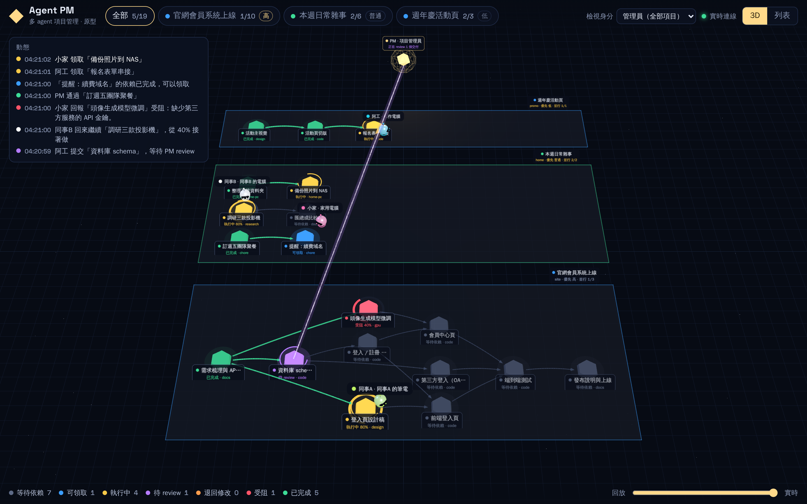
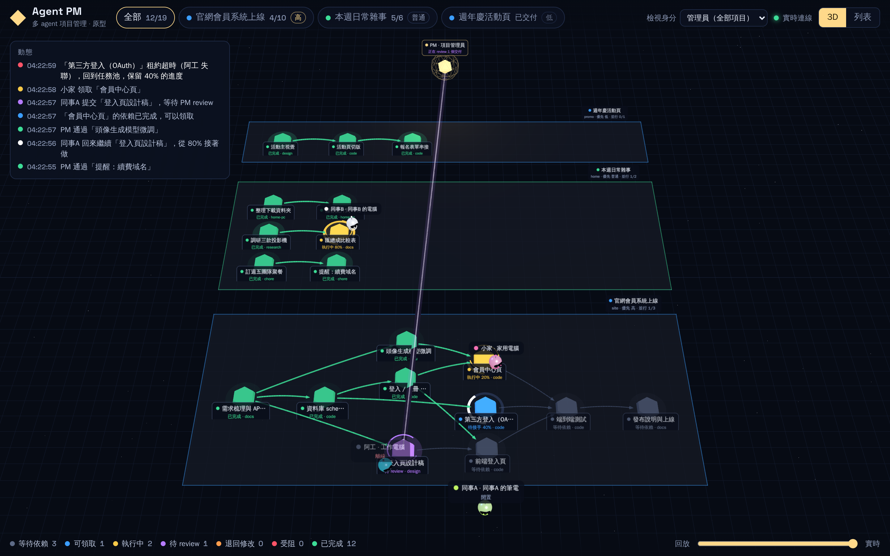
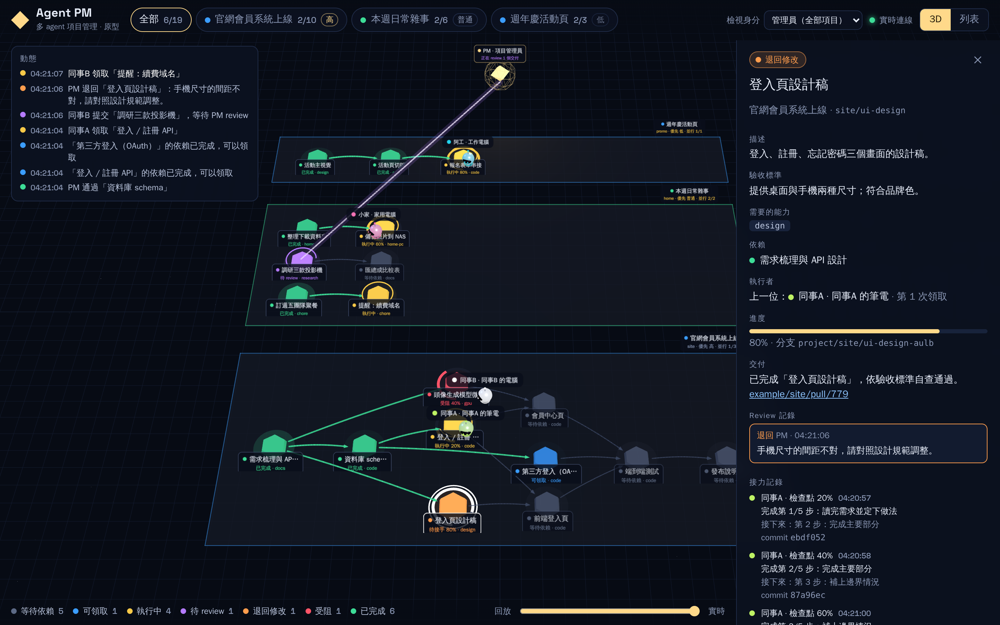
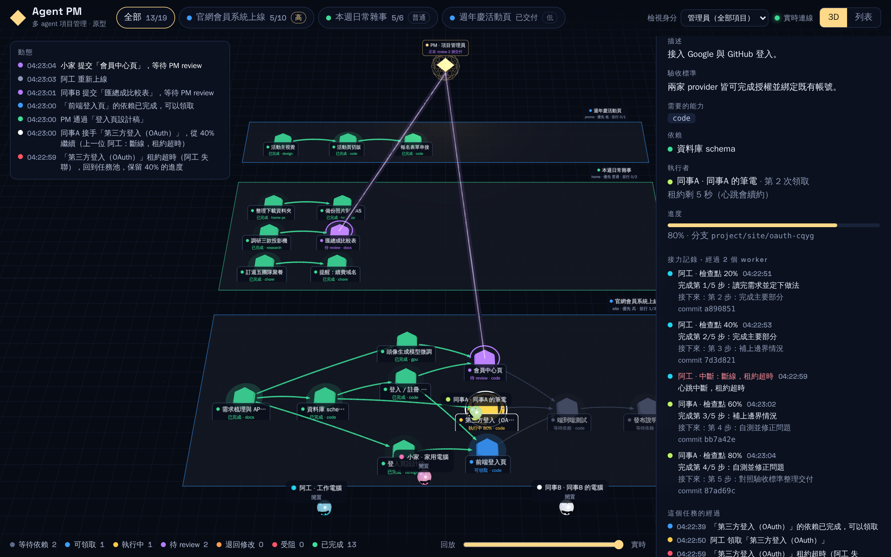
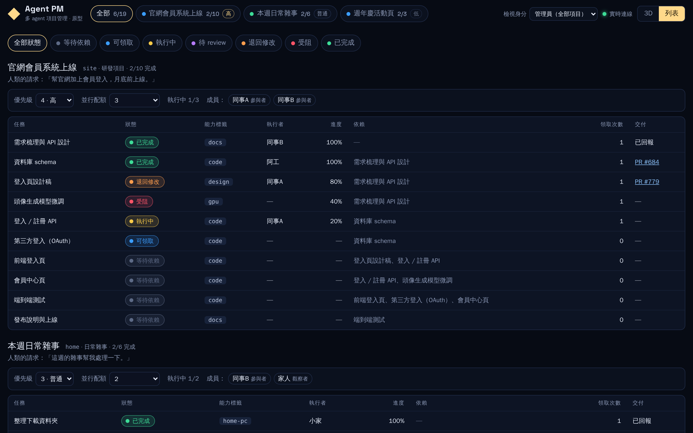
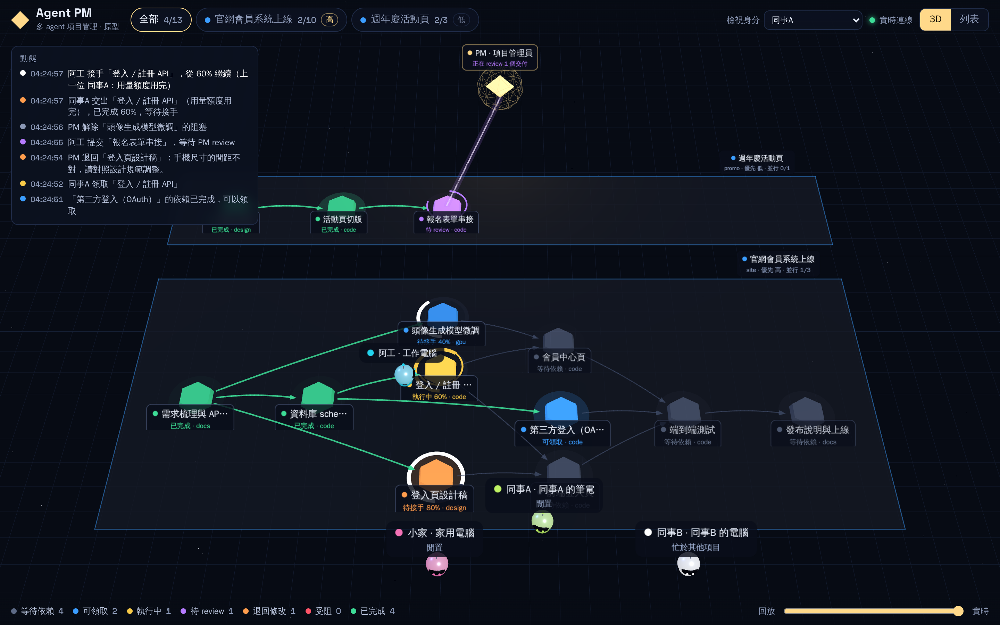

# Agent PM 原型：驗收與操作教程

這份教程分六條路線，由淺入深。每一步都寫了「你做什麼」和「應該看到什麼」，看到了就算這一項通過。

| 路線 | 需要什麼 | 時間 | 驗收什麼 |
| --- | --- | --- | --- |
| A. 只用瀏覽器 | 打開預覽鏈接 | 5 分鐘 | 3D 視窗、五種異常劇情、批准/退回、回放、列表、多項目的優先級和檢視身分 |
| B. 本機跑起來 | Node 20 以上 | 10 分鐘 | 協調服務、SQLite、自動測試 |
| C. 自己當 PM | 路線 B 的環境 | 15 分鐘 | 你親手建項目、開 worker、review、打斷、受阻、能力標籤 |
| D. 接真實 agent | Claude Code | 15 分鐘 | agent 通過 MCP 拆解、領取、交付 |
| E. 斷連後接手續作 | 路線 B 的環境，E4 起還需要 git | 20 分鐘 | 人工打斷、硬斷線、額度用完之後，另一個 worker 從檢查點接著做，而不是從頭開始 |
| F. 一個 PM 管多個項目 | 路線 B 的環境，需要 git | 20 分鐘 | 共用一個倉庫時分得清項目、優先級、並行配額、每個人只看得到自己的項目 |

最後有一張[驗收清單](#驗收清單)，可以邊做邊打勾。

先認識畫面：



- 每個項目是一塊檯面（泳道），任務按依賴從左到右排開。優先級高的項目排在最前面（最靠近你）。檯面右上角的標籤寫著項目短名、優先級和「並行 2/3」，意思是現在有 2 個任務在執行，配額是 3。
- 節點顏色：灰 等待依賴、藍 可領取、黃 執行中、紫 待 review、橙 退回修改、紅 受阻、綠 已完成。左下角有圖例和各狀態的數量。
- 做到一半的任務外圈有一段進度環，名字下面寫著「執行中 60%」。如果是中斷後等人接手，環是白色的，寫著「待接手 60%」。
- 小機器人是 worker，名字後面是它所在的電腦。後上方的金色晶體是 PM。
- 左上「動態」是最新事件，右上切換 3D / 列表，頂部一排是項目切換（名字後面的小標是優先級）。
- 右上角的「檢視身分」可以換成別人的視角，只顯示他參與的項目。

---

## 路線 A：只用瀏覽器

打開線上預覽「Agent PM 視窗」。右上角顯示「瀏覽器內模擬」，表示協調邏輯和模擬的 agent 都在你的瀏覽器裡跑，不需要安裝任何東西。
重新整理頁面會從頭開始。右上角的「速度 ×1」可以點成 ×2、×4。

### A1. 看懂正常流程（前 20 秒）

| 你做什麼 | 應該看到什麼 |
| --- | --- |
| 打開頁面，什麼都不點 | 三塊檯面，按優先級從前到後：「官網會員系統上線」（10 個任務，優先級高）、「本週日常雜事」（6 個任務，普通）、「週年慶活動頁」（3 個任務，低）。沒有依賴的節點是藍色，其餘是灰色 |
| 等幾秒 | 機器人飛到藍色節點上繞圈，節點變黃。這是 worker 領取了任務 |
| 再等幾秒 | 節點變紫，PM 向它照一道紫色光束。這是 worker 提交了交付，PM 在 review |
| 繼續看 | 節點變綠，一顆光點沿連線流向下游，下游節點由灰變藍。這是 review 通過後解鎖了下游 |

注意「頭像生成模型微調」只有「小家 · 家用電腦」會去領，因為它需要 `gpu` 標籤，只有家用電腦有。

### A2. 五種異常劇情

第一輪的劇情是固定的，下面的時間是速度 ×1 時的大約值。錯過了就重新整理，或者用 A5 的回放。
其中三種是「斷連」（人工打斷、額度用完、電腦斷線），它們的共同點是：任務回到任務池時進度不歸零，接手的人從上一個檢查點繼續。

| 大約時間 | 劇情 | 應該看到什麼 |
| --- | --- | --- |
| 16 秒 | **人工打斷** | 中間檯面的「調研三款投影機」做到 40% 時被打斷。動態出現「同事B 交出…（被人工打斷），已完成 40%，等待接手」，節點變回藍色，外圈留著一段白色進度環，下面寫「待接手 40%」。約 25 秒時同事B「回來繼續…從 40% 接著做」（這個任務要 `research` 標籤，只有同事B 有） |
| 25 秒 | **受阻** | 「頭像生成模型微調」變成紅色並閃爍，動態裡出現「小家 回報…受阻：…」。約 9 秒後 PM 解除阻塞，節點回到藍色，小家從 40% 接著做 |
| 31 秒 | **review 退回** | 「登入頁設計稿」由紫變橙，動態裡出現「PM 退回…」。同事A 忙完手上的事後（約 45 秒）回來繼續，從 80% 接著改 |
| 34 秒 | **額度用完** | 「登入 / 註冊 API」做到 60% 時，動態出現「同事A 交出…（用量額度用完），已完成 60%，等待接手」。約 1 秒後出現「阿工 接手…，從 60% 繼續（上一位 同事A：用量額度用完）」 |
| 41 到 49 秒 | **電腦斷線** | 阿工領了「第三方登入（OAuth）」，做到 40% 後停止心跳。節點先保持黃色，約 6 秒後動態出現「租約超時（阿工 失聯），回到任務池，保留 40% 的進度」，阿工的機器人變暗落回前排，節點變成「待接手 40%」。隨即「同事A 接手…，從 40% 繼續（上一位 阿工：斷線，租約超時）」。再過幾秒阿工「重新上線」 |



上圖是斷線剛被發現的那一刻：「第三方登入（OAuth）」是藍色、外圈有白色進度環，斷線的機器人變暗顯示離線。

三個項目的交付時間不同：優先級最低的「週年慶活動頁」任務最少，約 37 秒先做完；「本週日常雜事」約 54 秒；「官網會員系統上線」約 86 秒。
交付後檯面邊框變成金色、標題下顯示「PM 已交付」。全部交付後約 10 秒自動開始第 2 輪，之後的異常是隨機的。

### A3. 點節點看詳情

點任何一個節點，右邊打開側欄：



應該看到：狀態、描述、驗收標準、需要的能力、依賴（可以點過去）、執行者、領取次數、進度條和任務分支、交付內容和 PR 鏈接、review 記錄、接力記錄，以及最下面「這個任務的經過」。
點一個執行中（黃色）的節點，還會看到「租約剩 N 秒」：數字往下掉，每次心跳後又跳回 6，正常情況下在 4 到 6 之間來回。

點一個被接手過的任務（例如「第三方登入（OAuth）」），往下捲到「接力記錄 · 經過 2 個 worker」：



應該看到：進度條旁邊是任務分支 `project/site/oauth-xxxx`（中間的 `site` 是項目短名）。下面是按時間排列的檢查點，每條寫著是誰、做到百分之幾、完成了什麼、接下來要做什麼、對應的 commit；中間有一條紅字的「中斷：斷線，租約超時」；之後是接手的 worker 的檢查點，百分比接著往上走，而不是從 20% 重來。

點空白處或右上角的 × 關閉側欄。

### A4. 自己批准和退回

模擬的 PM 會在 2.5 到 4.5 秒內自動 review，所以要手快，或者先把速度留在 ×1。

1. 等某個節點變紫，立刻點它。
2. 側欄下方出現輸入框和「批准」「退回」兩個按鈕。
3. 在輸入框寫一句意見，點「退回」。

應該看到：節點變橙；側欄的「Review 記錄」多了一條「退回 你」和你寫的意見；動態裡出現「你 退回…」；幾秒後原來的 worker 重新領取，領取次數加 1。

如果按鈕已經消失，說明模擬的 PM 搶先處理了，換下一個紫色節點再試。想完全由自己掌控 review，請走路線 C。

同樣地，節點紅色（受阻）時點開，側欄有「解除阻塞，放回任務池」按鈕。

### A5. 回放

拖動右下角的「回放」滑桿往左。

應該看到：整個場景回到那個時間點的狀態，滑桿旁顯示時間和「第 N/M 個事件」，動態面板也只顯示到那一刻。回放期間側欄不顯示操作按鈕。
點「回到實時」或把滑桿拖到最右恢復。

### A6. 切換項目和列表

| 你做什麼 | 應該看到什麼 |
| --- | --- |
| 點頂部的「官網會員系統上線」 | 鏡頭飛近這個項目，其他項目變暗，worker 和 PM 跟著移到這塊檯面旁 |
| 點「全部」 | 回到總覽 |
| 拖拽、滾輪 | 旋轉和縮放 |
| 點右上角「列表」 | 每個項目一張表：任務、狀態、進度、能力標籤、執行者、依賴、領取次數、交付。表上方有一條項目設定（優先級、並行配額、成員）。上面可按狀態篩選，下面是每個 worker 的卡片（標籤、主人、在線狀態、正在做什麼）。點任一行同樣打開側欄 |

### A7. 多個項目：優先級、並行配額、檢視身分

三個項目的設定不一樣，可以在列表視圖每個項目上方的設定條看到：

| 項目 | 短名 | 優先級 | 並行配額 | 成員 |
| --- | --- | --- | --- | --- |
| 官網會員系統上線 | `site` | 4 · 高 | 3 | 同事A、同事B 是參與者 |
| 本週日常雜事 | `home` | 3 · 普通 | 2 | 同事B 是參與者，家人是觀察者 |
| 週年慶活動頁 | `promo` | 2 · 低 | 1 | 同事A 是負責人 |

你（預設的「管理員」身分）看得到全部。四個 worker 裡，阿工和小家是你的，同事A、同事B 的電腦各自屬於他們。



| 你做什麼 | 應該看到什麼 |
| --- | --- |
| 在 3D 視圖看每塊檯面右上角的標籤 | 寫著「site · 優先 高 · 並行 1/3」這樣的字。斜線前面是現在有幾個任務在執行，不會超過後面的配額；滿了的時候標籤變黃 |
| 切到「列表」，把「官網會員系統上線」的並行配額改成 1 | 動態（切回 3D 看）出現「PM 調整項目…：並行配額 3 → 1」。已經在做的任務不會被打斷，做完之後這個項目同一時間最多只有 1 個任務是「執行中」 |
| 把並行配額改成「0 · 暫停派工」 | 等手上的做完後，這個項目不再有任務被領取，3D 標籤顯示「已暫停」。改回 3 就恢復 |
| 把「官網會員系統上線」的優先級改成 1 | 頂部頁籤裡它排到最後，3D 裡它的檯面移到最後面。之後 worker 有別的項目的任務可領時會先做別的 |
| 右上角「檢視身分」選「同事A」 | 只剩「官網會員系統上線」和「週年慶活動頁」兩個項目，雜事項目整個消失，動態裡也沒有它的事件。小家如果正在做雜事，會顯示「忙於其他項目」 |
| 以同事A 的身分點一個官網的紫色節點 | 側欄寫著「你在這個項目裡是參與者，只有負責人可以 review」，沒有批准和退回按鈕。列表裡官網的設定條是灰的，旁邊寫「你是參與者，不能改設定」 |
| 「檢視身分」選「家人」 | 只剩「本週日常雜事」。家人是觀察者，什麼都不能改 |
| 選回「管理員（全部項目）」 | 三個項目都回來 |



「檢視身分」在這裡只是切換視角，方便你驗收。真正用 token 區分每個人、別人無法切換成你的身分，在路線 F 的 F3 驗證。

---

## 路線 B：本機跑起來

### B1. 安裝和啟動

需要 Node 20 以上（`node -v` 檢查）。解壓 `agent-pm-prototype.zip` 後：

```bash
cd agent-pm
npm install
npm run demo
```

應該看到終端輸出：

```
server| [server] 協調服務  http://localhost:4000
server| [server] MCP       http://localhost:4000/mcp
server| [server] 資料庫 .../data/demo.db，租約 6000ms
sim   | [sim] 已連上 http://localhost:4000，租約 6000ms，速度 x1
server| [event] task_claimed      同事B 領取「需求梳理與 API 設計」
```

（事件的具體內容和順序可能略有不同。）

打開 <http://localhost:4000>，右上角顯示綠點「實時連線」。畫面和劇情與路線 A 相同，區別是現在有一個真實的協調服務和 SQLite 資料庫，
模擬器是另一個進程，通過 REST 接口扮演 worker 和 PM。路線 A 的每一項在這裡都可以再做一遍。

`Ctrl+C` 停止。每次 `npm run demo` 都會清空示範資料庫 `data/demo.db` 重新開始。

4000 端口被佔用時換一個：`PORT=4100 npm run demo`（PowerShell：`$env:PORT="4100"; npm run demo`）。

### B2. 驗證事件是實時推送的

服務跑著的時候，另開一個終端：

```bash
curl http://localhost:4000/api/state
curl "http://localhost:4000/api/events?since=0"
```

應該看到：第一條返回所有項目、任務、worker 的 JSON；第二條返回事件日誌，每條帶 `type`、`message` 和變更後的任務快照。網頁就是靠同一批事件（經 WebSocket）更新的。

### B3. 跑自動測試

先 `Ctrl+C` 停掉示範（不停也可以，測試用自己的臨時端口和記憶體資料庫）：

```bash
npm test
```

應該看到兩組結果，`# pass 18` 和 `# pass 6`，`# fail 0`。它們覆蓋：

| 測試 | 驗證的設計點 |
| --- | --- |
| 拆解：無依賴的任務立即 ready | DAG 拆解 |
| 拆解：拒絕有環或依賴不存在的圖 | 必須是有向無環圖 |
| 領取：同一個任務只會被一個 worker 領到 | 原子領取 |
| 領取：能力標籤不符就領不到 | 能力標籤 |
| 完整流程：交付 → review 通過 → 解鎖下游 → 項目交付 | 主流程 |
| review 退回：優先還給原來的人，意見保留 | 退回重做 |
| 租約：心跳續約；超時後回到任務池，worker 標記離線 | 租約和心跳 |
| 受阻：report_blocked → blocked → unblock → ready | 受阻處理 |
| 檢查點：只有持有者能保存，保存即續約，進度記在任務上 | 檢查點 |
| 斷線接手：租約超時後別人領取，拿到最後一個檢查點，從那裡接著做 | 斷線續作；過期的原持有者再存檢查點或提交會被拒絕 |
| 主動交接：人工打斷或額度用完時立刻回到任務池，並優先留給別人 | 人工打斷、額度用完 |
| 斷線後自己回來：優先領回自己做到一半的任務 | 網路抖動後回來 |
| 共用倉庫：分支名帶項目短名，短名不能重複 | 一個倉庫裡分得清項目 |
| 優先級：先領優先級高的項目；PM 調整後立刻按新的順序 | 跨項目的優先級 |
| 並行配額：滿了就領不到這個項目的任務，名額空出來才能再領 | 跨項目的 agent 分配 |
| 權限：worker 只能領主人有權參與的項目；也可以自己限定只做某些項目 | 按項目的權限 |
| 權限：不是成員就看不到項目、任務和事件；別人的 worker 在看不到的項目裡做什麼會被抹掉 | 按項目的權限 |
| 權限：只有負責人能 review、改設定、管成員；只能操作自己的 worker | 按項目的權限 |
| REST：20 個 worker 同時搶 5 個任務，每個任務只被領一次 | 併發下的原子領取（真實 SQLite） |
| REST：錯誤會帶上 code | 接口錯誤處理 |
| MCP + WebSocket：PM 拆解、worker 領取交付、PM review，事件實時推送 | 用官方 MCP 客戶端走完整流程 |
| 續作：檢查點經 MCP 保存，交接後另一個 worker 領取時拿到 resume；協調服務重啟也不丟 | 檢查點存在 SQLite 裡，服務重啟後還在 |
| REST：並行配額在併發下不會超發（20 個 worker 同時搶配額為 2 的項目） | 配額檢查和領取是原子的 |
| 鑒權：每個人用自己的 token，只看得到自己參與的項目（REST、WebSocket、MCP 一致） | 真實的 token 鑒權，包括被加進項目後即時看到 |

---

## 路線 C：自己當 PM

這條路線不啟動模擬器，由你親手扮演人類和 PM，用 runner 的 dry-run 模式扮演 worker（它會假裝分 6 步幹活，每步 1.5 秒並存一個檢查點，約 9 秒後交付，不需要真的 agent）。
需要開三個終端，都在 `agent-pm` 目錄下。

下面的命令是 macOS / Linux 寫法。Windows PowerShell 請把 `A=1 B=2 命令` 改成 `$env:A="1"; $env:B="2"; 命令`，把 `curl` 改成 `curl.exe`。

### C1. 啟動空的協調服務（終端 1）

```bash
npm run demo -- --no-sim
```

打開 <http://localhost:4000>。應該看到：「實時連線」，場景裡只有網格，沒有任何項目。

### C2. 建立一個項目（終端 2）

工程裡準備了一個三步的例子 `docs/examples/project.json`（項目短名 `guestbook`）：留言 API → 留言區前端 → 發布公告，前兩個要 `code` 標籤，最後一個要 `docs` 標籤。

```bash
curl -X POST http://localhost:4000/api/projects \
  -H "content-type: application/json" \
  -d @docs/examples/project.json
```

應該看到：網頁上立刻出現一塊檯面和三個節點，「留言 API」是藍色（可領取），另外兩個是灰色（等待依賴）。動態裡出現「PM 建立項目…拆解為 3 個任務」。

想驗證「必須無環」，可以把檔案裡 `api` 任務加上 `"deps": ["notice"]` 再提交，會收到 `任務依賴存在環，必須是有向無環圖`。

### C3. 開一個 worker（終端 3）

```bash
WORKER_ID=my-pc WORKER_NAME=我的電腦 WORKER_MACHINE=筆電 WORKER_LABELS=code \
  npm run runner -- --dry-run
```

應該看到：

- 終端：`[runner my-pc] 領取 [guestbook]「留言 API」（第 1 次領取），從頭開始`，接著每 1.5 秒一行 `（dry-run）完成第 N/6 步`，最後 `agent 正常退出，已代為提交`。
- 網頁：出現機器人「我的電腦 · 筆電」，飛到「留言 API」上繞圈，節點變黃，外圈的進度環一格一格長出來，名字下面的百分比跟著漲；約 9 秒後節點變紫，PM 照下光束，機器人回到前排待命。

現在沒有模擬的 PM，任務會一直停在紫色等你。

### C4. 退回，再批准（網頁）

1. 點紫色的「留言 API」，在輸入框寫「缺少測試」，點「退回」。
   應該看到：節點變橙，寫著「待接手 80%」。5 秒內 runner 重新領取，終端顯示 `回來繼續 [guestbook]「留言 API」（第 2 次領取），從 80% 繼續。上一位：自己，review 退回`，並且只補做最後一步，不是六步重來。節點變黃，再變紫。側欄的 Review 記錄裡有你的退回意見。
2. 再點它，這次點「批准」。
   應該看到：節點變綠，光點流向「留言區前端」，它由灰變藍，隨即被 runner 領取變黃。

### C5. 打斷：驗證任務會帶著進度交出去

趁「留言區前端」還是黃色（執行中），在終端 3 按一次 `Ctrl+C`。

應該看到：

- 終端：`收到中斷信號，正在保存檢查點並交出任務…`，然後 `已保存檢查點並交出任務，其他 worker 可以立刻接手`，runner 退出。
- 網頁：節點立刻變回藍色（不用等租約超時），外圈留著白色進度環，寫著「待接手 N%」。動態出現「我的電腦 交出「留言區前端」（被人工打斷），已完成 N%，等待接手」。

點開節點可以看到「上一位：我的電腦」、進度條，以及接力記錄裡的檢查點和一條「中斷：被人工打斷」。
強殺進程、斷電這類「來不及打招呼」的斷線在路線 E 的 E3 驗證。

### C6. 受阻：驗證 blocked

在終端 3 啟動一個「一執行就失敗」的 worker（把 agent 命令換成 `false`，這次不加 `--dry-run`）：

```bash
WORKER_ID=my-pc WORKER_NAME=我的電腦 WORKER_MACHINE=筆電 WORKER_LABELS=code \
  AGENT_CMD=false npm run runner -- --once
```

應該看到：

- 終端：`回來繼續 [guestbook]「留言區前端」（第 2 次領取），從 N% 繼續。上一位：自己，被人工打斷`，然後 `agent 異常退出（code 1），已回報 blocked`，runner 退出。
- 網頁：節點變紅並閃爍。點開，側欄顯示「受阻原因：agent 異常退出…」和「解除阻塞，放回任務池」按鈕。

點「解除阻塞」。應該看到節點回到藍色。

（Windows 上沒有 `false` 命令，會顯示「無法啟動 agent」，效果一樣是受阻。）

### C7. 能力標籤和項目交付

1. 重新啟動 C3 的 dry-run worker。它領回「留言區前端」，終端顯示 `（dry-run）接續檢查點，跳過前 N 步`，做完剩下的步驟後提交。你在網頁上批准。
2. 「發布公告」變藍，但這個 worker **一直不會去領**。因為它需要 `docs` 標籤，而這個 worker 只有 `code`。這就是能力標籤的作用。
3. 開第四個終端，啟動一個有 `docs` 標籤的 worker：

   ```bash
   WORKER_ID=writer WORKER_NAME=文案 WORKER_MACHINE=同事的電腦 WORKER_LABELS=docs \
     npm run runner -- --dry-run
   ```

   應該看到：第二個機器人出現並領取「發布公告」。
4. 提交後你批准。

應該看到：三個節點全綠，檯面邊框變成金色，標題下顯示「PM 已交付」，動態裡出現「PM 交付項目…」。

到這裡，主流程（拆解 → 領取 → 交付 → review → 交付項目）和退回、打斷、受阻三種異常你都親手驗證過了。

---

## 路線 D：接真實 agent（MCP）

協調服務把所有操作暴露成 MCP 工具，支持 MCP 的 agent 配置一個地址就能用。這裡以 Claude Code 為例。

說明：MCP 工具我用官方 MCP 客戶端（自動測試）和 curl 驗證過，但沒有用真實的 Claude Code 會話完整走過這條路線，所以這一節請當作操作指引，遇到出入告訴我。

### D1. 用較長的租約啟動

示範的租約只有 6 秒，真實 agent 來不及幹活。先停掉其他服務，然後：

```bash
LEASE_MS=600000 npm run demo -- --no-sim      # 租約 10 分鐘
```

### D2. 不用 agent，先用 curl 確認 MCP 通了

```bash
curl -X POST http://localhost:4000/mcp \
  -H "content-type: application/json" \
  -H "accept: application/json, text/event-stream" \
  -d '{"jsonrpc":"2.0","id":1,"method":"tools/list"}'
```

應該看到：返回 16 個工具的定義，包括 `claim_task`、`heartbeat`、`save_checkpoint`、`release_task`、`submit_result`、`review_task`、`create_project`、`list_projects`、`update_project`、`set_project_member`。

### D3. 把 MCP 加到 Claude Code

```bash
claude mcp add --transport http agent-pm http://localhost:4000/mcp
claude mcp list        # 應該列出 agent-pm
```

協調服務在別的機器上時，把 `localhost` 換成它的地址。設置了 `PM_TOKEN` 的話再加 `--header "Authorization: Bearer <token>"`。

### D4. 讓 agent 當 PM

在 Claude Code 裡說：

> 你是項目管理員。用 agent-pm 的 create_project，把「給部落格加上留言功能」拆成 3 到 5 個有依賴關係的任務，每個任務寫清驗收標準，需要寫代碼的任務標籤用 code，寫文檔的用 docs。項目短名用 blog-comments，優先級 3。

應該看到：agent 調用 `create_project`（第一次會問你是否允許），網頁上出現新的檯面和節點。

之後有任務進入待 review 時，可以說：

> 用 agent-pm 的 list_tasks 找出 in_review 的任務，用 get_task 看交付內容，對照驗收標準逐個 review_task，不合格的寫明原因退回。

同時管多個項目時，可以讓它調度資源：

> 用 agent-pm 的 list_projects 看每個項目的優先級、並行配額和正在執行的任務數。如果有緊急的項目被別的項目擠住了，用 update_project 調高它的優先級，或者調低別的項目的並行配額。

### D5. 讓 agent 當 Worker

另開一個 Claude Code 會話，說：

> 你是 Worker。用 agent-pm 註冊成 worker_id 為 cc-1、標籤 code 的 worker，然後 claim_task 領一個任務。如果返回裡有 resume，說明有人做到一半，先讀它的 summary 和 next_steps，切到它給的分支，從那裡接著做，不要從頭開始。按任務描述和驗收標準完成任務，每完成一小步就 save_checkpoint 寫明做了什麼、接下來做什麼、進度百分比。完成後 submit_result 說明你做了什麼。做不下去就 report_blocked；如果只是你自己沒法繼續（例如額度快用完），先 save_checkpoint 再 release_task。

應該看到：網頁上出現機器人 cc-1 飛到節點上，節點變黃，每次 save_checkpoint 後進度環變長；agent 完成後節點變紫，等你或 PM agent review。

### D6. 讓 runner 常駐，自動啟動 agent

這是設想中每台電腦上的日常形態：runner 常駐，有任務就啟動本地 agent。

```bash
WORK_DIR=~/code/my-blog \
WORKER_ID=home-pc WORKER_NAME=小家 WORKER_MACHINE=家用電腦 WORKER_LABELS=code \
  npm run runner
```

- `WORK_DIR` 是 agent 幹活的目錄，通常是那台電腦上的代碼倉庫。
- 預設用 `claude -p "<任務提示詞>"` 啟動 agent，可以用 `AGENT_CMD` 換成別的命令。
- runner 負責領取和心跳。agent 正常退出時如果沒有自己調用 `submit_result`，runner 會把它的輸出尾部當作交付說明提交。
- 加上 `GIT_SYNC=1`，runner 會在領取時切到任務分支（別人做過就接著遠端的分支），每分鐘把未提交的改動 commit 並 push 一次當作自動檢查點。這樣即使 agent 自己從不存檢查點，換一台電腦也能拿到代碼。
- agent 異常退出時，輸出裡有 usage limit、rate limit、quota、額度這類字樣就當作額度用完：存檢查點、交出任務、這台電腦冷卻 10 分鐘（`COOLDOWN_MS`）。其他異常退出回報受阻。
- 按 `Ctrl+C` 會先停 agent、存檢查點、交出任務再退出。
- 心跳連不上超過一個租約時長後恢復：任務還沒被別人領走就領回來繼續，已經被領走就停掉 agent 並且不再 push。

---

## 路線 E：斷連後接手續作

這條路線驗收的是：agent 做到一半斷了，另一個 agent 能接著做，而不是從頭開始。

先說設計。每個任務上有三樣東西會一直跟著任務走，不跟著某個 worker 走：

- **進度**：0 到 100 的百分比。
- **接力記錄**：只增不改的一串記錄。agent 每完成一小步存一個**檢查點**（做了什麼、接下來做什麼、進度、commit）；每次中斷也記一條（是誰、什麼原因）。
- **任務分支**：每個任務固定一個 git 分支，例如 `project/site/doc-ehf2`（中間是項目短名）。代碼的中間成果 push 在這裡。

不管哪種斷連，任務都是帶著這三樣東西回到任務池，下一個領取的 worker 會收到一份「續作說明」（上一位是誰、為什麼停、做到哪、接下來做什麼、從哪個分支哪個 commit 接）。差別只在多快被發現：

| 斷連的種類 | 怎麼被發現 | 任務多久回到任務池 |
| --- | --- | --- |
| 人工打斷（Ctrl+C、關掉 agent） | runner 收到信號，先存檢查點再交出 | 立刻 |
| usage limit（額度用完） | agent 異常退出，輸出裡有 usage limit 之類的字樣 | 立刻，這台電腦冷卻 10 分鐘不再領任務 |
| 網路抖動、電腦睡眠、斷電、進程被強殺 | 心跳停了 | 一個租約時長（示範裡是 6 秒，正式預設 30 分鐘） |

這條路線用的練習項目沒有指定短名，協調服務會自動給一個（形如 `p-ab12`），下面的日誌裡寫成 `p-xxxx`。

和路線 C 一樣，命令是 macOS / Linux 寫法，都在 `agent-pm` 目錄下執行。Windows PowerShell 請把 `A=1 B=2 命令` 改成 `$env:A="1"; $env:B="2"; 命令`，把 `curl` 改成 `curl.exe`。

### E1. 在畫面上看接力

用線上預覽或 `npm run demo` 都可以，就是 A2 表格裡的三段劇情（16 秒人工打斷、34 秒額度用完、41 秒電腦斷線）。逐項確認：

| 你做什麼 | 應該看到什麼 |
| --- | --- |
| 看 41 到 49 秒的「第三方登入（OAuth）」 | 斷線後節點變藍但進度環還在，寫著「待接手 40%」；被接手後變黃，寫著「執行中 60%」「執行中 80%」，沒有回到 20% |
| 看左上的動態 | 有「…回到任務池，保留 40% 的進度」和「同事A 接手…，從 40% 繼續（上一位 阿工：斷線，租約超時）」 |
| 點這個節點，捲到「接力記錄」 | 標題是「經過 2 個 worker」。阿工的檢查點 20%、40%，一條紅字的中斷，然後是同事A 的檢查點 60%、80% |
| 切到「列表」 | 有「進度」一欄。等人接手的任務狀態是「可領取」，但進度不是 0 |

### E2. 人工打斷：按 Ctrl+C，另一個 worker 立刻接手

1. 終端 1 啟動空的協調服務（已經開著就先 `Ctrl+C` 再重開，資料會清空）：

   ```bash
   npm run demo -- --no-sim
   ```

   打開 <http://localhost:4000>。

2. 終端 2 建一個只有一個任務的項目：

   ```bash
   curl -X POST http://localhost:4000/api/projects \
     -H "content-type: application/json" \
     -d @docs/examples/handoff-project.json
   ```

3. 終端 3 啟動「電腦A」：

   ```bash
   WORKER_ID=pc-a WORKER_NAME=電腦A npm run runner -- --dry-run
   ```

4. 等終端 3 出現 `（dry-run）完成第 3/6 步` 左右，按一次 `Ctrl+C`。

   應該看到終端 3：

   ```
   [runner pc-a] 收到中斷信號，正在保存檢查點並交出任務…（再按一次強制退出）
   [runner pc-a] 已保存檢查點並交出任務，其他 worker 可以立刻接手
   ```

   網頁：節點立刻變藍，寫著「待接手 50%」（數字看你按的時機），動態出現「電腦A 交出…（被人工打斷），已完成 50%，等待接手」。

5. 還在終端 3，啟動「電腦B」：

   ```bash
   WORKER_ID=pc-b WORKER_NAME=電腦B npm run runner -- --dry-run
   ```

   應該看到：

   ```
   [runner pc-b] 接手 [p-xxxx]「寫一份五章的文件」（第 2 次領取），從 50% 繼續。上一位：pc-a，被人工打斷
   [runner pc-b] （dry-run）接續檢查點，跳過前 3 步，從第 4/6 步開始
   [runner pc-b] （dry-run）完成第 4/6 步
   ```

   **通過標準**：電腦B 沒有出現「完成第 1/6 步」，它是從電腦A 停下的下一步開始的。網頁動態有「電腦B 接手…，從 50% 繼續（上一位 電腦A：被人工打斷）」，點節點能看到兩個 worker 的接力記錄。

電腦B 做完後任務停在紫色，不用管它，讓電腦B 繼續開著。

### E3. 硬斷線：強殺進程，租約超時後被接手

這一步模擬斷電、當機、網路斷掉：worker 來不及說任何話就消失了。

1. 終端 2 再提交一次同一個項目（會多出一塊檯面），還開著的電腦B 會在 5 秒內領走新任務：

   ```bash
   curl -X POST http://localhost:4000/api/projects \
     -H "content-type: application/json" \
     -d @docs/examples/handoff-project.json
   ```

2. 等終端 3 出現新任務的 `（dry-run）完成第 3/6 步` 左右，在終端 2 強殺 runner：

   ```bash
   pkill -9 -f "runner.ts"
   ```

   （Windows 上沒有 `pkill`，可以直接關掉終端 3 的視窗，或在工作管理員裡結束 node 進程。這個做法我沒有在 Windows 上試過。）

   應該看到：終端 3 只有一行 `Killed`，沒有任何道別。網頁上節點**先保持黃色**，因為服務還不知道 worker 沒了。約 6 秒後動態出現「租約超時（電腦B 失聯），回到任務池，保留 50% 的進度」，節點變成「待接手 50%」，電腦B 的機器人變暗。（百分比看你下手的時機。）

3. 終端 3 啟動電腦A：

   ```bash
   WORKER_ID=pc-a WORKER_NAME=電腦A npm run runner -- --dry-run
   ```

   應該看到：

   ```
   [runner pc-a] 接手 [p-xxxx]「寫一份五章的文件」（第 2 次領取），從 50% 繼續。上一位：pc-b，斷線，租約超時
   [runner pc-a] （dry-run）接續檢查點，跳過前 3 步，從第 4/6 步開始
   ```

   **通過標準**：被強殺前存下的檢查點都在，接手的人從那之後開始。

如果第 3 步啟動的是同一個 `WORKER_ID=pc-b`，日誌會寫「回來繼續…上一位：自己，斷線，租約超時」。斷線的人回來時，會優先領回自己做到一半的任務。

做完後在終端 3 按 `Ctrl+C` 停掉 runner。

### E4. 額度用完：另一台電腦從 git 分支接著寫

前兩步的 dry-run 只是數步數。這一步讓兩個 worker 在**兩個不同的工作目錄**裡真的寫同一份檔案，中間成果靠 git 傳遞，就像兩台電腦一樣。需要裝了 git。

工程裡有一個假 agent（`docs/examples/fake-agent.mjs`）：它的任務是往 `work/doc.md` 裡寫五章，每章 2 秒，每章註明是誰寫的。它開工前會先看檔案裡已經有幾章，從下一章接著寫。

1. 終端 1 重啟協調服務（`Ctrl+C` 後再 `npm run demo -- --no-sim`），讓資料清空。

2. 終端 2 建一個小實驗室，再建項目：

   ```bash
   node scripts/make-handoff-lab.mjs
   curl -X POST http://localhost:4000/api/projects \
     -H "content-type: application/json" \
     -d @docs/examples/handoff-project.json
   ```

   第一條命令會建立 `lab/remote.git`（當作 GitHub）、`lab/pc-a` 和 `lab/pc-b`（兩台電腦各自的 clone）。

3. 終端 3 啟動電腦A，並讓假 agent 寫完第 2 章後「額度用完」：

   ```bash
   WORKER_ID=pc-a WORKER_NAME=電腦A WORK_DIR=lab/pc-a GIT_SYNC=1 FAKE_FAIL_AT=2 \
     npm run runner -- --fake-agent
   ```

   應該看到：

   ```
   [runner pc-a] 領取 [p-xxxx]「寫一份五章的文件」（第 1 次領取），從頭開始
   [runner pc-a] 已從 origin/main 建立任務分支 project/p-xxxx/doc-xxxx
   檔案是空的，從第 1 章開始
   寫完第 1/5 章
   寫完第 2/5 章
   Error: usage limit reached, try again later
   [runner pc-a] agent 額度用完，已保存檢查點並交出任務
   [runner pc-a] 冷卻 600 秒後再領任務
   ```

   網頁：節點變成「待接手 40%」，動態出現「電腦A 交出…（用量額度用完），已完成 40%，等待接手」。電腦A 在冷卻，不會自己把任務領回去。

4. 終端 4 啟動電腦B（沒有 `FAKE_FAIL_AT`）：

   ```bash
   WORKER_ID=pc-b WORKER_NAME=電腦B WORK_DIR=lab/pc-b GIT_SYNC=1 \
     npm run runner -- --fake-agent
   ```

   應該看到：

   ```
   [runner pc-b] 接手 [p-xxxx]「寫一份五章的文件」（第 2 次領取），從 40% 繼續。上一位：pc-a，用量額度用完
   [runner pc-b] 已切到任務分支 project/p-xxxx/doc-xxxx（接續遠端 8c81b10）
   檔案裡已有 2 章，從第 3 章接著寫
   寫完第 3/5 章
   寫完第 4/5 章
   寫完第 5/5 章
   全部 5 章完成，本次寫了第 3 到 5 章
   [runner pc-b] agent 正常退出，已代為提交
   ```

5. 終端 2 檢查成果：

   ```bash
   cat lab/pc-b/work/doc.md
   git -C lab/remote.git log --oneline --all
   ```

   **通過標準**：檔案裡五章各出現一次，第 1、2 章寫著「由 pc-a 完成」，第 3 到 5 章寫著「由 pc-b 完成」。git 記錄裡有一筆 `[p-xxxx/doc] 額度用完前的最後狀態` 和一筆 `[p-xxxx/doc] 完成`。也就是電腦B 拿到了電腦A 的檔案，沒有重寫前兩章。

做完後在終端 3、4 按 `Ctrl+C`。

### E5.（選做，僅 macOS / Linux）網路抖動：不誤殺，也不互相覆蓋

網路抖動時 worker 其實還活著，只是心跳送不出去。這裡用「暫停 runner 進程」來模擬：runner 不動了，它啟動的 agent 還在繼續寫。要驗兩件事。

**沒人接手時，原來的 worker 回來接著做。** 照 E4 的第 1、2 步清空重來，然後終端 3：

```bash
WORKER_ID=pc-a WORKER_NAME=電腦A WORK_DIR=lab/pc-a GIT_SYNC=1 \
  FAKE_NO_CHECKPOINT=1 FAKE_STEP_MS=5000 AUTO_CHECKPOINT_MS=4000 \
  npm run runner -- --fake-agent
```

（`FAKE_NO_CHECKPOINT=1` 讓假 agent 不自己存檢查點，否則它存檢查點時會順便續約，就斷不了線。`AUTO_CHECKPOINT_MS=4000` 讓 runner 每 4 秒自動 commit 並 push 一次。）

出現 `寫完第 1/5 章` 後，終端 2：

```bash
pkill -STOP -f "runner.ts"; sleep 10; pkill -CONT -f "runner.ts"
```

應該看到：網頁上約 6 秒後出現租約超時，節點變藍。10 秒到了之後終端 3 出現 `租約曾經超時，但任務還沒被接手，已重新領回，繼續執行`，假 agent 沒有被打斷，一路寫完五章。

**已經有人接手時，原來的 worker 讓位，不覆蓋對方。** 再清空重來一次，終端 3 用同一條命令啟動電腦A。出現 `寫完第 2/5 章` 後：

```bash
pkill -STOP -f "runner.ts"          # 終端 2：電腦A 斷網
```

終端 4 啟動電腦B（E4 第 4 步的命令）。約 6 秒後電腦B 顯示 `接手…上一位：pc-a，斷線，租約超時`、`已切到任務分支…（接續遠端 …）`、`檔案裡已有 2 章，從第 3 章接著寫`。然後：

```bash
pkill -CONT -f "runner.ts"          # 終端 2：電腦A 的網路恢復
```

應該看到終端 3：`任務已被別的 worker 接手，停止 agent（本機未推送的改動保留在本地，不會覆蓋對方）`。

**通過標準**：`git -C lab/remote.git log --oneline --all` 最上面一筆是 pc-b 的「完成」，`lab/pc-b/work/doc.md` 五章各一次。電腦A 斷網期間多寫的章節留在 `lab/pc-a` 本地沒有推上去。

這裡電腦B 的日誌會寫「從 0% 繼續」，因為 runner 的自動檢查點只知道 commit，不知道做到百分之幾。百分比要靠 agent 自己存檢查點時填。

### E6. 我驗證過什麼，沒驗證過什麼

驗證過（在 Linux 上，對著真實的協調服務和 SQLite，租約 6 秒）：

- E2 到 E5 的每一條命令和「應該看到」的輸出，都是我實際跑出來的。
- 自動測試裡的五項續作測試（見 B3），包括協調服務重啟後檢查點還在。
- 畫面上的進度環、「待接手」、接力記錄，用無頭瀏覽器截圖核對過。

沒有驗證過：

- **真實的 agent**。假 agent 是「看檔案有幾章就接著寫」，真實的 Claude Code 能不能讀懂續作說明、老老實實從上一位停下的地方接著做而不是推倒重來，要靠你實測（D5、D6）。
- **真實的 usage limit 長什麼樣**。runner 現在是靠 agent 輸出裡有沒有 usage limit、rate limit、quota、額度這些字樣來判斷的（可用 `HANDOFF_PATTERN` 改）。Claude Code 真的用完額度時輸出什麼、退出碼是多少，我沒有條件試。
- **Windows**。信號處理（Ctrl+C 的交接）和 `GIT_SYNC` 在 Windows 上沒跑過。
- **真的兩台電腦和真的 GitHub**。E4 是同一台機器上的兩個目錄加一個本地的裸倉庫。
- **代碼衝突**。兩個 worker 不會同時 push 同一個任務分支（已經讓位的那個不再 push），但電腦A 沒推上去的那部分改動目前只是留在它本地，沒有機制合併回來。

---

## 路線 F：一個 PM 管多個項目

這條路線驗收三件事：

1. **所有項目共用一個倉庫，但分得清。** 每個項目有一個短名（例如 `site`）。它的任務分支一律是 `project/site/<任務名>-<編號>`；每個 commit 的標題以 `[site/<任務名>]` 開頭，結尾有 `Project: site`、`Task: …`、`Worker: …` 三行。
2. **優先級和並行配額。** 優先級（1 到 5）決定 worker 先領哪個項目的任務；並行配額限制一個項目同時最多佔幾個 worker。
3. **按項目的權限。** 每個人有自己的 token，只看得到自己是成員的項目。角色分三種：負責人可以 review、改設定、管成員；參與者的 worker 可以領任務；觀察者只能看。

在畫面上先看一遍可以走 A7。下面是親手驗。命令是 macOS / Linux 寫法，都在 `agent-pm` 目錄下執行。

### F1. 兩個項目共用一個倉庫：優先級、配額、分支

用 E4 的那個小實驗室：`lab/remote.git` 當作共用的倉庫，`lab/pc-a`、`lab/pc-b` 是兩台電腦各自的 clone。
兩個練習項目各有兩個互不依賴的任務：

| 檔案 | 短名 | 優先級 | 並行配額 | 任務 |
| --- | --- | --- | --- | --- |
| `docs/examples/multi-site.json` | `site` | 4 · 高 | 1 | `api`、`ui` |
| `docs/examples/multi-blog.json` | `blog` | 2 · 低 | 不限 | `post`、`rss` |

1. 終端 1 重啟協調服務（`Ctrl+C` 後再執行），打開 <http://localhost:4000>：

   ```bash
   npm run demo -- --no-sim
   ```

2. 終端 2 建實驗室，然後**先建優先級低的 blog，再建 site**：

   ```bash
   node scripts/make-handoff-lab.mjs
   curl -X POST http://localhost:4000/api/projects -H "content-type: application/json" -d @docs/examples/multi-blog.json
   curl -X POST http://localhost:4000/api/projects -H "content-type: application/json" -d @docs/examples/multi-site.json
   ```

   應該看到：網頁上兩塊檯面，後建的「官網改版」反而排在前面，因為它優先級高。標籤是「site · 優先 高 · 並行 0/1」和「blog · 優先 低 · 並行 0」。

3. 終端 3 啟動電腦A。`FAKE_COMMIT=1` 讓假 agent 每寫完一章自己 commit 一次，訊息只寫「寫完第 N 章」，故意不帶任何項目標記：

   ```bash
   WORKER_ID=pc-a WORKER_NAME=電腦A WORK_DIR=lab/pc-a GIT_SYNC=1 FAKE_COMMIT=1 FAKE_STEP_MS=3000 \
     npm run runner -- --fake-agent
   ```

   應該看到：

   ```
   [runner pc-a] 領取 [site]「官網：寫 API 文件」（第 1 次領取），從頭開始
   [runner pc-a] 已從 origin/main 建立任務分支 project/site/api-xxxx
   ```

   **優先級通過標準**：blog 先建立、任務也排在前面，但電腦A 領的是 site 的任務。

4. 馬上在終端 4 啟動電腦B（同一條命令，把 `pc-a`、`電腦A` 換成 `pc-b`、`電腦B`）：

   ```bash
   WORKER_ID=pc-b WORKER_NAME=電腦B WORK_DIR=lab/pc-b GIT_SYNC=1 FAKE_COMMIT=1 FAKE_STEP_MS=3000 \
     npm run runner -- --fake-agent
   ```

   應該看到：

   ```
   [runner pc-b] 領取 [blog]「部落格：寫搬家公告」（第 1 次領取），從頭開始
   [runner pc-b] 已從 origin/HEAD 建立任務分支 project/blog/post-xxxx
   ```

   **配額通過標準**：site 還有一個可領的任務（`ui`），優先級也更高，但電腦B 領的是 blog。因為 site 的並行配額是 1，已經被電腦A 佔了。網頁上 site 的標籤變成黃色的「並行 1/1」，整個過程中 site 不會同時有兩個黃色節點。

5. 等大約 40 秒，四個節點都變紫。兩個終端都按 `Ctrl+C`。

6. 終端 2 到共用的倉庫裡查：

   ```bash
   git -C lab/remote.git branch --list 'project/*'
   git -C lab/remote.git branch --list 'project/site/*'
   git -C lab/remote.git log --all --oneline --grep='Project: blog'
   git -C lab/remote.git log --all -1 --grep='Project: site' --format=%B
   git -C lab/remote.git log --all --oneline --invert-grep --grep='Project: '
   ```

   應該看到（編號和 commit 每次不同）：

   ```
   # 第一條：四個任務分支，按項目分在兩個前綴下
     project/blog/post-dyua
     project/blog/rss-5ube
     project/site/api-2zol
     project/site/ui-sg3o
   # 第二條：只列出 site 的
     project/site/api-2zol
     project/site/ui-sg3o
   # 第三條：blog 項目的全部提交，一共 10 筆，標題都以 [blog/…] 開頭
   b884f28 [blog/rss] 寫完第 5 章
   …
   e28ad82 [blog/post] 寫完第 1 章
   # 第四條：一筆 site 的提交的完整訊息
   [site/ui] 寫完第 5 章

   Project: site
   Task: t_993lsg3o
   Worker: pc-a
   # 第五條：不帶項目標記的提交，只有實驗室初始化的那一筆
   e17a206 init
   ```

   **共用倉庫通過標準**：分支按 `project/<項目短名>/` 分開；假 agent 自己 commit 時只寫了「寫完第 N 章」，倉庫裡的訊息卻都帶著 `[項目/任務]` 開頭和三行標記（這是 runner 裝在工作目錄的 git hook 補上的）；除了 `init` 沒有任何一筆分不清項目的提交。

### F2. 隨時調整優先級和配額

在 A7 裡用網頁的列表視圖調過了。這裡用命令再調一次，確認 PM agent 走同一個接口也行（F1 的服務不用重啟）：

```bash
curl -X PATCH http://localhost:4000/api/projects/blog \
  -H "content-type: application/json" -d '{"priority": 5, "max_parallel": 1}'
```

應該看到：返回的 JSON 裡 `"priority":5,"max_parallel":1`；網頁上「部落格搬家」的檯面換到最前面，標籤變成「blog · 優先 緊急 · 並行 0/1」，動態出現「PM 調整項目「部落格搬家」：優先級 2 → 5，並行配額 不限 → 1」。
網址裡的 `blog` 是項目短名，也可以用項目 id。

（PowerShell 裡這條命令的 JSON 要寫成 `-d '{\"priority\": 5, \"max_parallel\": 1}'`，下一節的也一樣。）

### F3. 權限：每個人只看得到自己的項目

1. 終端 1 `Ctrl+C`，帶上管理員 token 重新啟動：

   ```bash
   PM_TOKEN=admin-secret npm run demo -- --no-sim
   ```

   應該看到啟動日誌最後一行有「已啟用 token 鑒權」。從現在起，沒有 token 連讀都不行：

   ```bash
   curl -i http://localhost:4000/api/state      # 第一行是 HTTP/1.1 401 Unauthorized
   ```

   不帶 token 打開 <http://localhost:4000>，右上角顯示「token 無效」，場景是空的。

2. 終端 2，用管理員 token 建兩個用戶。每個用戶的 token 只在這時顯示一次（服務端只存雜湊），把它們記下來：

   ```bash
   A="authorization: Bearer admin-secret"
   J="content-type: application/json"
   curl -X POST http://localhost:4000/api/users -H "$A" -H "$J" -d '{"id":"amy","name":"Amy"}'
   curl -X POST http://localhost:4000/api/users -H "$A" -H "$J" -d '{"id":"bob","name":"Bob"}'
   ```

   應該看到：`{"user":{"id":"amy",…},"token":"pm_…"}`。把兩個 token 存成變量：

   ```bash
   AMY=pm_這裡貼上Amy的token
   BOB=pm_這裡貼上Bob的token
   ```

3. 建兩個項目，把 Amy 設成 site 的參與者，Bob 設成 blog 的負責人：

   ```bash
   curl -X POST http://localhost:4000/api/projects -H "$A" -H "$J" -d @docs/examples/multi-site.json
   curl -X POST http://localhost:4000/api/projects -H "$A" -H "$J" -d @docs/examples/multi-blog.json
   curl -X PUT http://localhost:4000/api/projects/site/members/amy -H "$A" -H "$J" -d '{"role":"contributor"}'
   curl -X PUT http://localhost:4000/api/projects/blog/members/bob -H "$A" -H "$J" -d '{"role":"manager"}'
   ```

4. 用三個人的 token 各看一次有哪些項目：

   ```bash
   curl -s http://localhost:4000/api/state -H "$A" | grep -o '"key":"[a-z]*","priority"'
   curl -s http://localhost:4000/api/state -H "authorization: Bearer $AMY" | grep -o '"key":"[a-z]*","priority"'
   curl -s http://localhost:4000/api/state -H "authorization: Bearer $BOB" | grep -o '"key":"[a-z]*","priority"'
   ```

   **通過標準**：管理員看到 `site` 和 `blog` 兩行，Amy 只有 `site`，Bob 只有 `blog`。

   網頁也一樣，開三個分頁：

   | 網址 | 應該看到 |
   | --- | --- |
   | `http://localhost:4000/?token=admin-secret` | 兩個項目，右上角有「檢視身分」選單 |
   | `http://localhost:4000/?token=<Amy 的 token>` | 只有「官網改版」，右上角顯示「Amy」，沒有「檢視身分」選單 |
   | `http://localhost:4000/?token=<Bob 的 token>` | 只有「部落格搬家」，右上角顯示「Bob」 |

5. 終端 3，用 Amy 的 token 啟動她的 worker：

   ```bash
   PM_TOKEN=$AMY WORKER_ID=amy-pc WORKER_NAME="Amy 的電腦" npm run runner -- --dry-run
   ```

   （終端 3 是另一個視窗，要先在裡面執行一次 `AMY=pm_…`。）

   應該看到：

   ```
   [runner amy-pc] 身分：Amy（只會領到自己參與的項目的任務）
   [runner amy-pc] 領取 [site]「官網：寫 API 文件」（第 1 次領取），從頭開始
   …
   [runner amy-pc] 領取 [site]「官網：寫介面文件」（第 1 次領取），從頭開始
   …
   [runner amy-pc] agent 正常退出，已代為提交
   ```

   **通過標準**：做完 site 的兩個任務後它就閒下來了。管理員的網頁上 blog 的兩個任務一直是藍色（可領取），Amy 的 worker 不會去領，因為 Amy 不是 blog 的成員。

6. 驗證角色的差別（終端 2）。第一條命令先取出「官網：寫 API 文件」這個任務的 id：

   ```bash
   TID=$(curl -s http://localhost:4000/api/state -H "$A" | grep -o '"id":"t_[a-z0-9]*","project_id":"[a-z0-9_]*","project_key":"site","key":"api"' | cut -d'"' -f4)
   echo $TID      # 應該印出一個 t_ 開頭的 id
   curl -X POST http://localhost:4000/api/tasks/$TID/review -H "authorization: Bearer $AMY" -H "$J" -d '{"decision":"approve"}'
   curl -X POST http://localhost:4000/api/tasks/$TID/review -H "authorization: Bearer $BOB" -H "$J" -d '{"decision":"approve"}'
   curl -X PATCH http://localhost:4000/api/projects/site -H "authorization: Bearer $BOB" -H "$J" -d '{"priority":1}'
   curl -X PATCH http://localhost:4000/api/projects/blog -H "authorization: Bearer $BOB" -H "$J" -d '{"priority":5}'
   curl -X POST http://localhost:4000/api/tasks/$TID/review -H "$A" -H "$J" -d '{"decision":"approve","reviewer":"隨便填"}'
   ```

   應該依次看到：

   | 誰做什麼 | 結果 |
   | --- | --- |
   | Amy（site 的參與者）review site 的任務 | `Amy 在項目「官網改版」裡沒有這個權限（需要 manager）` |
   | Bob（不是 site 的成員）review site 的任務 | `任務 … 不存在`。看不到的東西一律說不存在 |
   | Bob 改 site 的優先級 | `項目 site 不存在` |
   | Bob（blog 的負責人）改 blog 的優先級 | 成功，返回 `"priority":5` |
   | 管理員 review | 成功，`"state":"done"`。review 記錄裡的名字是 `PM`（token 對應的人），不是請求裡填的「隨便填」 |

   在 Amy 的網頁上點一個紫色節點，側欄寫著「你在這個項目裡是參與者，只有負責人可以 review」，沒有批准按鈕。

7. 讓 Amy 的網頁開著，管理員把她加進 blog 當觀察者：

   ```bash
   curl -X PUT http://localhost:4000/api/projects/blog/members/amy -H "$A" -H "$J" -d '{"role":"viewer"}'
   ```

   **通過標準**：Amy 的網頁不用重新整理，馬上多出「部落格搬家」。再把她移出去，項目又馬上消失：

   ```bash
   curl -X DELETE http://localhost:4000/api/projects/blog/members/amy -H "$A"
   ```

做完後終端 3 按 `Ctrl+C`。想回到不鑒權的示範，終端 1 `Ctrl+C` 後照常 `npm run demo`。

MCP 同樣按 token 過濾。接 Claude Code 時帶上 header：

```bash
claude mcp add --transport http agent-pm http://localhost:4000/mcp --header "Authorization: Bearer <這個人的 token>"
```

之後這個 agent 用 `list_projects`、`list_tasks` 只看得到這個人的項目，註冊的 worker 也登記在這個人名下。這一步我用官方 MCP 客戶端測過（見 B3 的最後一項測試），沒有用真實的 Claude Code 測。

### F4. 我驗證過什麼，沒驗證過什麼

驗證過（Linux，真實的協調服務和 SQLite）：

- F1 到 F3 的每一條命令和「應該看到」的輸出，都是我實際跑出來的，包括 Amy 的網頁在被加進、移出項目時即時變化。
- A7 表格裡的每一行，用無頭瀏覽器操作並核對過：改配額後官網同時執行的任務不超過 1 個，暫停後降到 0，改優先級後頁籤順序改變，三種身分各自看到的項目。
- 自動測試新增 8 項（見 B3），包括 20 個 worker 同時搶配額為 2 的項目、不會超發。

沒有驗證過：

- **真實的 agent 會不會守規矩。** 分支名是協調服務定的，runner 會切好；commit 標記有 git hook 兜底。但如果 agent 自己執行 `git checkout` 跑到別的分支，或者用 `--no-verify` 跳過 hook，現在沒有東西攔它。
- **真的 GitHub。** 共用倉庫用的是本地的裸倉庫。GitHub 上可以再加分支保護規則（例如 `project/site/*` 只允許某些人 push），這次沒有做。
- **Windows。** git hook 是一段 sh 腳本，Git for Windows 應該能執行，但我沒有試。
- **多人同時用的真實場景。** token 是長期有效的，沒有過期、輪換和登入頁；`?token=` 會把 token 留在網址裡。這些離正式使用還有距離。
- **代碼層面的隔離。** 權限只管協調服務裡的數據。倉庫是共用的，能讀倉庫的人仍然看得到所有項目的分支和代碼。

---

## 驗收清單

| # | 驗收項 | 對應你的方案 | 怎麼驗 | 通過標準 |
| --- | --- | --- | --- | --- |
| 1 | 請求被拆成有依賴的任務圖 | PM 分解需求 | C2 | 提交後出現節點和連線；有環的圖被拒絕 |
| 2 | Worker 領取任務 | Worker 領取需求 | A1 / C3 | 藍色節點被機器人領取後變黃 |
| 3 | 同一任務不會被兩個 worker 領到 | 多 agent 協同 | B3 | 「20 個 worker 搶 5 個任務」測試通過 |
| 4 | 只有具備能力的電腦能領 | 分散在不同電腦 | A1 / C7 | `gpu` 任務只有家用電腦領；`docs` 任務 `code` worker 不領 |
| 5 | Worker 交付，帶 PR 鏈接 | Worker 完成交付 | A3 | 側欄「交付」有說明和 PR 鏈接 |
| 6 | PM review 通過後解鎖下游 | PM review 改動 | A1 / C4 | 節點變綠，光點流向下游，下游變藍 |
| 7 | PM review 退回後重做 | PM review 改動 | A2 / A4 / C4 | 節點變橙，原 worker 帶著意見重新領取，領取次數加 1 |
| 8 | 人可以在網頁上批准、退回 | 人類介入 | A4 / C4 | 點按鈕後狀態立刻改變，記錄裡署名「你」 |
| 9 | 電腦斷線後任務自動回收 | 分散在不同電腦 | A2 / E3 | 約一個租約時長後節點回到藍色，worker 顯示離線 |
| 10 | 任務受阻可以上報和解除 | 異常處理 | A2 / C6 | 節點紅色閃爍並顯示原因；解除後回到藍色 |
| 11 | 全部完成後項目交付 | PM 交付 | A2 / C7 | 檯面邊框變金色，顯示「PM 已交付」 |
| 12 | 進度實時可見，可回放 | 可視化 | A5 / A6 | 不重新整理頁面就更新；滑桿能回到任一時刻 |
| 13 | Agent 可經 MCP 操作 | 多 agent 接入 | B3 / D2 | MCP 測試通過；curl 能列出 16 個工具 |
| 14 | 真實 agent 走完整流程 | 多 agent 接入 | D4 到 D6 | 這一項我沒有驗證過，需要你實測 |
| 15 | 中斷的任務帶著進度回到任務池 | 斷連後續作 | A2 / E1 | 節點顯示「待接手 N%」，進度環不歸零 |
| 16 | 人工打斷後別的 worker 立刻接手，從檢查點繼續 | 斷連後續作 | C5 / E2 | 接手的 runner 顯示「跳過前 N 步」，沒有從第 1 步重來 |
| 17 | 硬斷線（強殺、斷電）在租約超時後被接手 | 斷連後續作 | A2 / E3 | 約一個租約時長後出現「保留 N% 的進度」，接手者從那之後開始 |
| 18 | 額度用完自動交接，另一台電腦從 git 分支接著做 | 斷連後續作 | A2 / E4 | `doc.md` 前兩章署名 pc-a、後三章署名 pc-b，每章只出現一次 |
| 19 | 誰做了哪一段可以追溯 | 斷連後續作 | A3 / E1 | 側欄「接力記錄」列出每個 worker 的檢查點和每次中斷的原因 |
| 20 | 網路抖動不誤殺、不互相覆蓋 | 斷連後續作 | E5（選做） | 沒人接手時原 worker 領回繼續；有人接手時原 worker 停下且不 push |
| 21 | 協調服務重啟後檢查點不丟 | 斷連後續作 | B3 | 「續作…協調服務重啟也不丟」測試通過 |
| 22 | 真實 agent 斷連後被另一個真實 agent 接手 | 斷連後續作 | D5 / D6 | 這一項我沒有驗證過，需要你實測 |
| 23 | 共用一個倉庫時，分支分得清是哪個項目的 | 一個 PM 管多個項目 | A3 / F1 | 分支都是 `project/<項目短名>/…`；`git branch --list 'project/site/*'` 只列出 site 的 |
| 24 | commit 分得清是哪個項目的，包括 agent 自己提交的 | 一個 PM 管多個項目 | F1 | `git log --grep='Project: blog'` 列出 blog 的全部提交；除了 `init` 沒有不帶標記的提交 |
| 25 | 優先級高的項目先拿到 worker | 一個 PM 管多個項目 | A7 / F1 | 後建立但優先級高的 site 先被領取 |
| 26 | 並行配額限制一個項目同時佔用的 worker | 一個 PM 管多個項目 | A7 / F1 / B3 | 配額為 1 的 site 不會同時有兩個任務在執行，第二個 worker 被分到 blog |
| 27 | PM 可以隨時調整優先級和配額，立刻生效 | 一個 PM 管多個項目 | A7 / F2 | 動態出現「PM 調整項目…」，檯面順序和並行數跟著變 |
| 28 | 每個人只看得到自己參與的項目 | 一個 PM 管多個項目 | A7 / F3 | 三個 token 看到的項目各不相同；被加進項目後不用重新整理就看到 |
| 29 | worker 只會領主人有權參與的項目的任務 | 一個 PM 管多個項目 | F3 | Amy 的 worker 做完 site 就閒下來，不碰 blog |
| 30 | 只有負責人能 review 和改設定 | 一個 PM 管多個項目 | A7 / F3 | 參與者 review 被拒絕；非成員得到「不存在」 |
| 31 | 真實 agent、真實 GitHub、多人同時使用 | 一個 PM 管多個項目 | F4 | 這一項我沒有驗證過，需要你實測 |

---

## 常見問題

**網頁右上角顯示「瀏覽器內模擬」而不是「實時連線」？**
網頁連不上協調服務時會自動退回瀏覽器內模擬。確認服務在跑，並且打開的是服務輸出的那個地址。

**`npm install` 在編譯 better-sqlite3 時失敗？**
它在常見系統上有預編譯包。失敗通常是 Node 版本太新或太舊，換成 Node 20 或 22 的 LTS 版本再試。

**runner 顯示「出錯，稍後重試」？**
多半是連不上協調服務。檢查 `PM_URL`（預設 `http://localhost:4000`）。

**場景裡的字太小？**
點頂部某個項目把鏡頭拉近，或者用滾輪放大。任務多的時候用右上角的「列表」更好找。

**runner 顯示「冷卻 600 秒後再領任務」，想讓它馬上繼續？**
`Ctrl+C` 停掉再啟動就可以，冷卻只存在這個進程裡。也可以用 `COOLDOWN_MS=5000` 縮短。

**runner 顯示「無法準備任務分支，已交出任務」？**
`GIT_SYNC=1` 時 `WORK_DIR` 必須是一個有 `origin` 遠端的 git 倉庫。E4 請先執行 `node scripts/make-handoff-lab.mjs`。

**網頁右上角顯示「token 無效」？**
服務是帶著 `PM_TOKEN` 啟動的。在網址後面加上 `?token=<你的 token>`；管理員的 token 就是啟動時設的 `PM_TOKEN`。

**建項目時提示「項目短名 … 已被另一個項目使用」？**
還在用的項目之間短名不能重複（分支名靠它區分）。換一個 `key`，或者先重啟示範服務清空資料。

**runner 顯示「已有別的 hook，沒有覆蓋」？**
工作目錄的 `.git/hooks/prepare-commit-msg` 已經有你自己的 hook。runner 不會動它，這時 agent 自己的 commit 不會自動帶項目標記，runner 代提交的仍然會帶。

**想清空重來？**
`npm run demo` 每次啟動都會清空示範資料庫。正式模式（`npm run server`）的資料在 `data/pm.db`，刪掉這個檔案即可。
